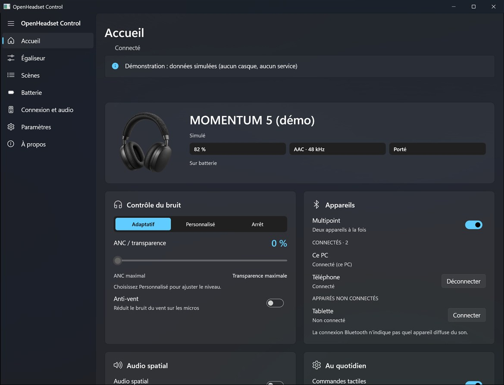
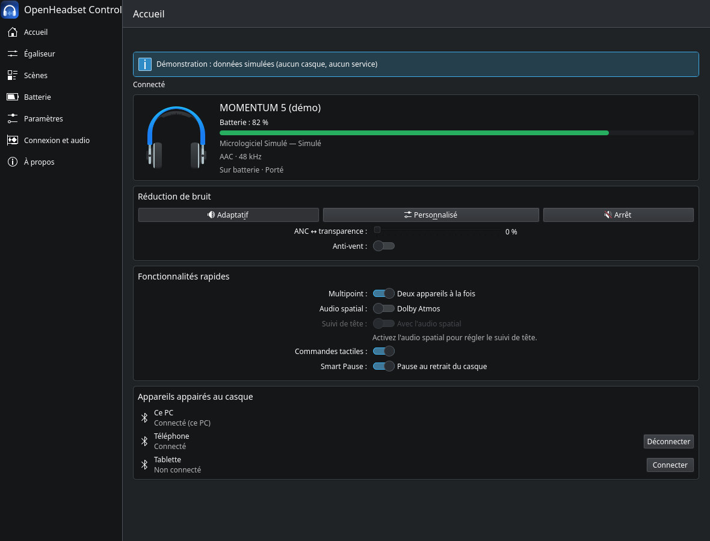
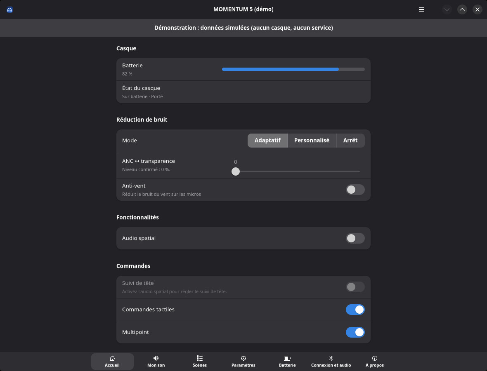

<div align="center">


# OpenHeadset Control

**Régler le casque Sennheiser MOMENTUM 5 depuis son PC.**<br>
Réduction de bruit, égaliseur, scènes et batterie sous Windows 11 et Linux, sans l'application mobile.

[](https://github.com/Asfax03L/momentum-5-control/actions/workflows/ci.yml)
[](https://github.com/Asfax03L/momentum-5-control/releases/latest)
[](https://github.com/Asfax03L/momentum-5-control/releases)
[](#installer)
[](#licence)

[English](README.md) · **Français**

[**Télécharger**](https://github.com/Asfax03L/momentum-5-control/releases/latest) ·
[Guide d'utilisation](docs/GUIDE.md) ·
[Questions fréquentes](docs/FAQ.md) ·
[Site](https://asfax03l.github.io/momentum-5-control/) ·
[Discussions](https://github.com/Asfax03L/momentum-5-control/discussions)

</div>

> [!IMPORTANT]
> **Projet non officiel, sans lien avec Sennheiser ni Sonova.** Le protocole a
> été reconstitué à partir de documentation publique et de captures de
> l'application officielle. Seules les commandes capturées puis validées sur le
> casque sont envoyées. L'application ne met jamais à jour le micrologiciel, ne
> réinitialise jamais le casque et ne supprime jamais un appairage.

| Windows 11 · WinUI 3 | KDE Plasma · Kirigami | GNOME · libadwaita |
|---|---|---|
|  |  |  |

<sub>Captures en mode démonstration (`--demo` : casque simulé). Toutes les pages
des trois interfaces : [docs/INTERFACES.md](docs/INTERFACES.md).</sub>

## Pourquoi OpenHeadset Control

- **Une interface native par bureau.** WinUI 3 sous Windows, Kirigami sous KDE
  Plasma, libadwaita sous GNOME. Derrière elles, un seul cœur en Rust et un seul
  service.
- **Vous voyez ce que le casque annonce.** Chaque réglage affiche la valeur
  relue sur le casque, jamais une valeur supposée.
- **Vie privée.** Aucun compte, aucune télémétrie. Tout reste sur le PC. Le
  diagnostic à joindre à un rapport de bogue masque les noms, les adresses et le
  numéro de série.
- **Prudent par construction.** Une commande n'est envoyée qu'après avoir été
  capturée dans l'application officielle, puis validée sur un vrai casque. Tout
  le reste est en lecture seule.

## Fonctions

| | |
|---|---|
| 🎧 **Bruit** | Modes Adaptatif, Personnalisé et Arrêt, curseur ANC ↔ transparence, anti-vent, audio spatial et suivi de tête |
| 🎚️ **Son** | Égaliseur 8 bandes, amplification des basses, préréglages, courbes importées et exportées, comparaison A/B, assistant EQ guidé, Speech Clarity, profil personnalisé |
| 🎬 **Scènes** | Un ensemble de réglages appliqué en un clic, au raccourci clavier, à la connexion du casque ou à heure fixe |
| 🔋 **Batterie** | Niveau, courbe sur 30 jours, autonomie mesurée, avis « batterie faible » et « 100 % câble branché » |
| 📞 **Appels et confort** | Smart Pause, réponse automatique, appels confortables, retour de voix (sidetone), invites, extinction automatique, protection de la batterie, nom du casque |
| 🔗 **Connexions** | Appareils appairés au casque, Multipoint, reconnexion, choix du codec Bluetooth sous Linux |
| 🖥️ **Bureau** | Icône de la zone de notification et panneau rapide, raccourcis globaux, widget Plasma, recherche KRunner, module Waybar, extension Decky pour le mode jeu, ligne de commande `ctl` |
| 🌍 **Langues** | Français et anglais, dans chaque interface |

## Installer

Téléchargez la dernière version sur la page
[Releases](https://github.com/Asfax03L/momentum-5-control/releases/latest).
Chaque fichier est publié avec son empreinte SHA-256
([vérifier un fichier](docs/VERIFIER.md)).

| Système | Fichier |
|---|---|
| Windows 10/11 | `…-windows-x86_64-installateur.exe` — par utilisateur, sans droits administrateur ; demande Windows App Runtime 2 |
| Bazzite et autres systèmes en lecture seule | `…-x86_64.flatpak` — `flatpak install --user …` |
| Debian, Ubuntu | `openheadset-control_…_amd64.deb` |
| Fedora | `openheadset-control-….x86_64.rpm` |
| Autres Linux | `…-linux-x86_64.tar.gz`, puis `./installer-linux.sh` |

Le casque doit être appairé et connecté au PC. Le téléphone peut rester
connecté en même temps (Multipoint). Les exécutables ne sont pas signés :
SmartScreen peut demander une confirmation.

Pas à pas, depuis les sources, et désinstallation :
[docs/INSTALLATION.md](docs/INSTALLATION.md) et [docs/LINUX.md](docs/LINUX.md).

## Compatibilité

| Casque | Micrologiciel | Réglages |
|---|---|---|
| MOMENTUM 5 Wireless (`M5AEBT`) | 6.21.5 | ✅ Écritures validées sur le casque, sous Windows 11 et Bazzite 44 |
| MOMENTUM 5, autre micrologiciel | — | 🔒 Lecture seule jusqu'à vérification |
| Autres casques GAIA (MOMENTUM 4, ACCENTUM…) | — | 🔒 Lecture seule, jamais essayés |

Commande par commande : [docs/COMPATIBILITE.md](docs/COMPATIBILITE.md).
Vous avez un autre modèle ou un autre micrologiciel ? Un
[rapport de compatibilité](https://github.com/Asfax03L/momentum-5-control/issues/new/choose)
aide beaucoup.

## Ligne de commande

Tout ce que font les interfaces se fait aussi depuis un terminal :

```bash
ctl etat                 # état : batterie, mode de bruit, codec…
ctl mode adaptatif       # mode de bruit : arret | adaptatif | personnalise
ctl niveau 50            # 0 = ANC max, 50 = neutre, 100 = transparence max
ctl scene Travail        # appliquer une scène
ctl --json etat          # un seul objet JSON, pour les scripts
```

Liste complète : [docs/CTL.md](docs/CTL.md), ou `ctl --help`.

## Documentation

| Sujet | Français | English |
|---|---|---|
| Utiliser l'application | [Guide](docs/GUIDE.md) · [FAQ](docs/FAQ.md) | [Guide](docs/GUIDE.en.md) · [FAQ](docs/FAQ.en.md) |
| Installation | [INSTALLATION.md](docs/INSTALLATION.md) | [INSTALLATION.en.md](docs/INSTALLATION.en.md) |
| Compatibilité | [COMPATIBILITE.md](docs/COMPATIBILITE.md) | [COMPATIBILITE.en.md](docs/COMPATIBILITE.en.md) |
| Contribuer | [CONTRIBUTING.fr.md](CONTRIBUTING.fr.md) | [CONTRIBUTING.md](CONTRIBUTING.md) |
| Sécurité | [SECURITY.fr.md](SECURITY.fr.md) · [SECURITE.md](docs/SECURITE.md) | [SECURITY.md](SECURITY.md) |
| Les interfaces, page par page | [INTERFACES.md](docs/INTERFACES.md) | — |
| Linux : Flatpak, paquets, service, Waybar | [LINUX.md](docs/LINUX.md) | — |
| Ligne de commande | [CTL.md](docs/CTL.md) | — |
| Fiche du protocole du MOMENTUM 5 | [MOMENTUM5.md](docs/MOMENTUM5.md) | — |
| Le code | [ARCHITECTURE.md](docs/ARCHITECTURE.md) · [parité des interfaces](docs/PARITE.md) | — |
| Versions et suite du projet | [CHANGELOG.md](CHANGELOG.md) · [compatibilité en 1.x](docs/VERSIONS.md) · [ROADMAP.md](docs/ROADMAP.md) | — |

## Compiler depuis les sources

Il faut Rust (la version essayée est figée dans `rust-toolchain.toml`).

```bash
# Windows : l'interface WinUI, en démonstration (sans casque)
cargo run --release --bin momentum-winui -- --demo
```

```bash
# Linux : service, ligne de commande, client KDE et client GNOME
cargo build --release -p momentum-daemon -p momentum-cli -p momentum-kirigami -p momentum-gtk
```

Les clients Linux demandent Qt 6 avec Kirigami (KDE) et GTK 4 avec libadwaita
(GNOME). Détails : [docs/INSTALLATION.md](docs/INSTALLATION.md).

## Contribuer

Rapports de bogue, rapports de compatibilité et PR sont les bienvenus, en
français ou en anglais : voir [CONTRIBUTING.fr.md](CONTRIBUTING.fr.md).
Les questions vont dans les
[Discussions](https://github.com/Asfax03L/momentum-5-control/discussions).
Une faille de sécurité se signale en privé : [SECURITY.fr.md](SECURITY.fr.md).

## Licence

Au choix [MIT](LICENSE-MIT) ou [Apache-2.0](LICENSE-APACHE). Aucun code tiers
n'est copié : tout est réimplémenté à partir de faits documentés ou observés
([sources](docs/COMPATIBILITE.md#sources)).

Sennheiser et MOMENTUM sont des marques de leurs propriétaires respectifs. Ce
projet est indépendant et n'est pas approuvé par eux.
