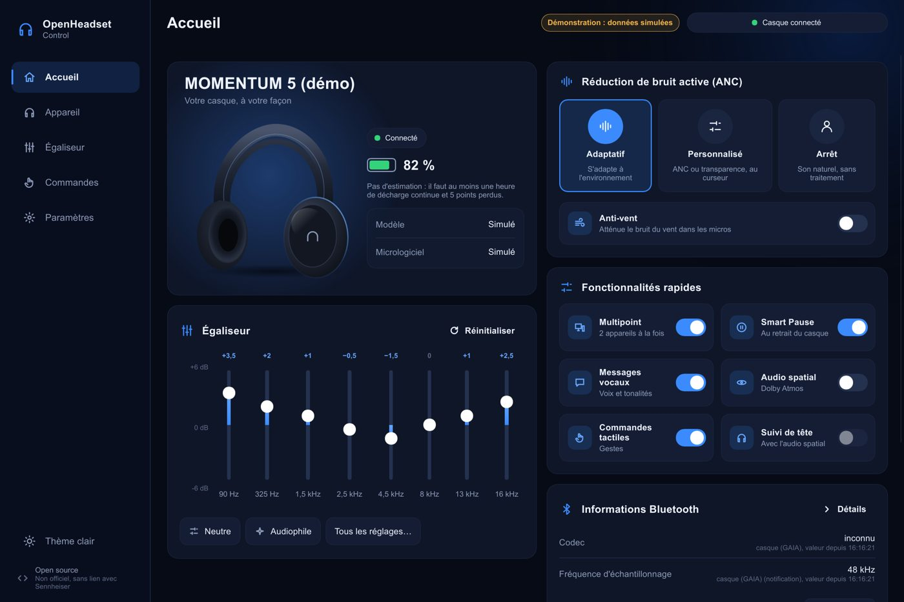

# momentum-ctl-win — OpenHeadset Control


**OpenHeadset Control** : contrôle léger des casques Sennheiser **MOMENTUM 5**
sous Windows 11 et Linux (KDE Plasma, Bazzite ; Wayland natif), en Rust, comme
alternative à l'application mobile Smart Control Plus : une icône dans la
barre système, une fenêtre principale, un client natif KDE (Qt 6 / Kirigami)
et deux outils en ligne de commande.

> ⚠️ **Projet non officiel, non affilié à Sennheiser ni à Sonova.** Le protocole
> a été reconstitué à partir de documentation publique et de captures de
> l'application officielle. Utilisation à vos risques. Le projet n'implémente
> **ni** mise à jour du firmware, **ni** réinitialisation d'usine, **ni**
> aucune commande d'écriture qui n'a pas été capturée puis validée sur le
> matériel.

## État du projet

| Phase | Contenu | État |
|---|---|---|
| 1 | Protocole GAIA V3 pur, `MockTransport`, tests sur captures | ✅ |
| 2 | `probe` : diagnostic Bluetooth en lecture seule | ✅ |
| 3 | Réglages du bruit et de l'audio spatial (`ctl`) | ✅ validé sur M5 |
| 4 | Icône dans la barre système, notifications, reconnexion | ✅ validé sur M5 |
| 5 | Fenêtre d'égaliseur (Slint, thème Fluent) | ✅ validé sur M5 |
| A–D | Fenêtre principale complète : Accueil, Mon son, Réglages, À propos | ✅ validé sur M5 |
| E | Raccourcis clavier globaux, notifications Windows, archive publiée | ✅ validé sur le PC (v0.2.0) |
| F | Expériences sur le casque : volume des invites, nom, connexions | ✅ validé sur M5 (v0.3.0) |
| G | Espace de travail Cargo : cœur, service, outils, interfaces séparés | ✅ (v0.7.0) |
| H | Linux : `ctl` et icône Slint par BlueZ, KDE Plasma sous Wayland | ✅ validé sur M5 (v0.7.0) |
| I | Interface OpenHeadset Control (thèmes, disposition adaptative, démo) | ✅ validé sur M5 (v0.7.0) |
| J | Client natif KDE Qt 6 / Kirigami (Linux), logo, entrées de menu ; client du service, icône de la zone de notification, raccourcis KDE | 🟡 essayé sur M5, non publié |
| K | Service `momentum-daemon` et API D-Bus, `ctl` client du service (Linux) | 🟡 essayé sur M5 (lecture et écriture), non publié |
| L | Logo sous Windows : exécutable, menu Démarrer, notifications, icône d'état | 🟡 non publié |
| M | Service sous Windows (canal nommé) et client WinUI 3 (`windows-reactor`) | 🟡 essayé sur M5 (lecture), non publié |

Dernière publication : **v0.7.0** (page Releases du dépôt). Le détail des
étapes est dans [`docs/ROADMAP.md`](docs/ROADMAP.md), les nouveautés de chaque
version dans [`CHANGELOG.md`](CHANGELOG.md).

## Limites documentées

Le protocole du MOMENTUM 5 est décrit dans [docs/MOMENTUM5.md](docs/MOMENTUM5.md) : chaque commande y est marquée validée sur le casque, ou seulement lue. Seules les écritures validées sont envoyées.

## Installation

Prérequis : Windows 10/11 avec Bluetooth, et le casque **appairé et
connecté** au PC (Paramètres > Bluetooth et appareils).

**Sans Rust** : télécharger l'archive de la page Releases du dépôt
(publiée par la CI à chaque étiquette `v*`, avec son empreinte SHA-256) :
`openheadset-control-vX.Y.Z-windows-x86_64.zip` ou
`openheadset-control-vX.Y.Z-linux-x86_64.tar.gz`, la décompresser, puis
lancer l'installateur qu'elle contient. Les exécutables ne sont pas signés :
SmartScreen peut demander une confirmation.

**Windows** (depuis les sources : Rust stable 1.88 ou plus récent) :

```bash
powershell -ExecutionPolicy Bypass -File scripts\installer.ps1
```

Le script installe, sans droits administrateur, dans
`%LOCALAPPDATA%\Programs\momentum-ctl-win` :
- par défaut l'interface **WinUI 3** (`momentum-winui.exe`), le service
  `momentum-daemon.exe` qu'elle lance au besoin, et `ctl.exe`. Il faut le
  Windows App Runtime 2 (le script prévient s'il manque) ;
- avec `-Interface slint`, l'ancienne icône Slint (`momentum-tray.exe`).

Il prend les exécutables posés à côté de lui (archive) ou, à défaut,
compile la version release. Il inscrit l'interface choisie au démarrage de
Windows (WinUI démarre caché : l'icône seule), retire l'autre, ajoute
« OpenHeadset Control » au menu Démarrer et la lance. Pour tout retirer :
`scripts\installer.ps1 -Desinstaller`.

**Linux (KDE Plasma)** : depuis l'archive, `./installer-linux.sh` ; depuis
les sources (voir [docs/LINUX.md](docs/LINUX.md) pour les paquets ; sur
Bazzite, dans une boîte distrobox) :

```bash
cargo build --release -p momentum-cli -p momentum-daemon -p momentum-kirigami
```
```bash
sh scripts/installer-linux.sh
```

Le script installe pour l'utilisateur courant, sans `sudo` : binaires dans
`~/.local/bin`, logo dans le thème d'icônes, entrées « OpenHeadset Control »
dans le menu des applications (KDE y trouve aussi l'icône des fenêtres sous
Wayland), service avec son unité systemd utilisateur et son activation
D-Bus. Le client Kirigami demande Qt 6 et Kirigami (présents sous KDE).

Pour un simple essai sans installation :

```bash
cargo run --release --bin momentum-tray
```

L'icône d'un casque apparaît près de l'horloge (au besoin, dans les icônes
cachées, flèche **^**). Avec `--fenetre`, la fenêtre principale s'ouvre dès
le lancement ; avec `--egaliseur`, elle s'ouvre sur la page « Mon son ». Le téléphone peut rester connecté au casque en même
temps : le M5 accepte le PC en multipoint.

## Interface OpenHeadset Control

Fenêtre Slint au thème bleu nuit (thème clair dans Paramètres ou dans la
navigation, choix gardé dans `apparence.txt`). Cinq sections : **Accueil**
(tableau de bord), **Appareil** (connexion et audio, batterie), **Égaliseur**
(mode audio, courbe, préréglages, fichiers, A/B), **Commandes** (tactile,
raccourcis, scènes, panneau rapide), **Paramètres** (casque, application).



Thème clair, petite fenêtre : [accueil clair](docs/captures/accueil-clair.jpg),
[accueil mobile](docs/captures/accueil-mobile.jpg),
[égaliseur mobile](docs/captures/egaliseur-mobile-clair.jpg). Captures du mode
démonstration (`--capture`) : valeurs simulées.

- **S'adapte à la taille réelle de la fenêtre** : navigation latérale et
  tableau de bord sur deux colonnes (≥ 1100 px), navigation en rail et
  colonnes qui se replient (720 à 1100 px), une colonne avec navigation en
  bas sous 720 px.
- **Rien n'est présenté comme appliqué avant la réponse du casque** : au
  clic, un interrupteur ou une tuile garde l'état confirmé et affiche une
  roue d'attente ; « Envoi au casque… » s'affiche en haut jusqu'à l'état
  relu (ou au refus, signalé dans le bandeau).
- **Construite d'après le casque** : nombre de bandes, fréquences et plage
  de l'égaliseur, réglages disponibles et micrologiciel viennent des
  lectures ; un réglage non lu est affiché comme indisponible.
- **Mode démonstration** : `momentum-tray --demo` montre l'interface avec des
  données simulées, sans Bluetooth (bandeau « Démonstration : données
  simulées » permanent ; ni historique de batterie, ni notification, ni
  lecture du système). `momentum-tray --capture <dossier>` enregistre en PNG
  le rendu de chaque section à plusieurs tailles (vérification de la
  disposition), puis s'arrête.

## Icône dans la barre système (`momentum-tray`)

- **Panneau rapide** (clic gauche sur l'icône, ou `momentum-tray --panneau`) :
  petit panneau près de l'horloge avec la batterie, les trois modes de bruit,
  le curseur ANC ↔ transparence, le profil personnalisé, quatre scènes au plus
  et « Ouvrir la fenêtre ». Il se ferme avec Échap, « Fermer », ou dès qu'une
  autre fenêtre passe au premier plan.
- **Fenêtre principale** (« Ouvrir la fenêtre » du panneau, ou « Ouvrir la
  fenêtre… ») : navigation Accueil, Mon son (égaliseur), Réglages, Batterie,
  À propos ;
  en-tête avec le casque, la connexion, le codec (« aptX · 44,1 kHz ») et
  la batterie ; bandeau pour les incidents et le mode audio. **Accueil** :
  modes de bruit, curseur ANC ↔ transparence, anti-vent, audio spatial
  (grisé tant que le profil personnalisé est sélectionné) et suivi de tête
  (réglable avec l'audio spatial actif), commandes
  tactiles, scènes, appareils appairés au casque avec Connecter / Déconnecter
  (sauf ce PC) et interrupteur Multipoint (confirmation avant de le couper,
  car un seul appareil reste alors connecté). **Mon son** :
  choix du mode audio (égaliseur, Speech Clarity, profil personnalisé),
  export du profil dans Documents, égaliseur, préréglages (« Neutre » et
  « Audiophile » de l'app, plus les vôtres, enregistrés dans
  `%LOCALAPPDATA%\momentum-ctl-win\prereglages.txt`), saisie des 8 gains au
  clavier (« -3,5 ; -1 ; … »), export et import de courbes (fichier texte
  versionné, refusé pour un autre modèle ou un autre nombre de bandes),
  comparaison A/B des gains. **Réglages** : Smart
  Pause, réponse automatique, appels confortables, extinction automatique,
  protection de la batterie, invites et volume des invites (curseur en %,
  échelle relevée dans l'app), nom du casque, éditeur des raccourcis
  clavier (scènes comprises) ; langue des invites et priorité
  du mode audio en lecture seule. **Batterie** : courbe sur 24 h, 7 ou
  30 jours (fichier local `batterie.csv`, export CSV, effacement confirmé),
  estimation du temps restant seulement après une heure de décharge continue ;
  les périodes sans mesure restent vides, et ni état de charge, ni santé, ni
  cycles ne sont inventés. **À propos** : modèle, micrologiciel, révision
  matérielle, et **diagnostic expurgé** à copier dans un rapport de bogue
  (ni nom, ni adresse Bluetooth, ni numéro de série, ni chemin personnel, ni
  profil auditif ; affiché avant toute copie, rien n'est envoyé).
- **Clic droit** : mode (ANC adaptatif / Personnalisé / Désactivé), curseur
  ANC ↔ transparence en 5 crans, anti-vent, audio spatial, Speech Clarity,
  Personnalisation du son (profil déjà enregistré ; coupe Dolby Atmos comme
  l'app),
  **Égaliseur…** (fenêtre sur « Mon son »), Réglages du casque (Smart Pause, réponse automatique aux
  appels, appels confortables, extinction automatique, invites, commandes
  tactiles, protection de la batterie), Scènes, Lancer au démarrage de
  Windows, Quitter.
- **Infobulle** : nom du casque, batterie, mode actuel, et le mode audio
  s'il n'est pas l'égaliseur.
- **Mode audio et profil** : une ligne du menu montre le mode audio
  (égaliseur, Speech Clarity, mode 3, valeur inconnue) et, séparément,
  l'état du profil de personnalisation du son.
- **Incidents visibles** : une connexion perdue ou un réglage refusé
  s'affiche en tête du menu, dans l'infobulle et dans la fenêtre de
  l'égaliseur, jusqu'à la reconnexion ou la commande suivante. La fenêtre
  signale aussi quand le mode audio actif n'est pas l'égaliseur graphique.
- **Commandes regroupées** : si plusieurs réglages s'empilent (curseur au
  clavier, clics rapides), seule la dernière valeur de chacun est envoyée,
  avec une seule relecture.
- **Réglages non lus grisés** : si le casque refuse la lecture d'un réglage
  facultatif, seul ce réglage est grisé (« non lu » dans `ctl etat`) ; le
  reste fonctionne.
- **Couleur de l'icône** : bleu = ANC, vert d'eau = adaptatif, orange =
  transparence (curseur > 50 %), gris clair = désactivé, gris = déconnecté.
- Reste synchronisée avec l'app du téléphone et les boutons du casque
  (notifications GAIA). Si le casque disparaît, la perte est détectée
  aussitôt et l'icône se reconnecte seule (essai toutes les 5 s).
- **Lancer au démarrage de Windows** : case à cocher dans le menu.
- **Raccourcis clavier globaux** (page Réglages, ou fichier
  `%LOCALAPPDATA%\momentum-ctl-win\raccourcis.txt`, créé au premier
  lancement ; une scène s'écrit `scene:Nom = Ctrl+Alt+1`) : **Ctrl+Alt+N** mode de bruit
  suivant (Adaptatif → Personnalisé → Arrêt), **Ctrl+Alt+P** profil
  personnalisé ou égaliseur, **Ctrl+Alt+M** ouvrir la fenêtre. Un raccourci
  déjà pris par une autre application est signalé dans le bandeau.
- **Notifications Windows** : batterie faible (une fois sous 15 %, réarmée
  au-dessus de 20 %), casque déconnecté, puis reconnecté (jamais au simple
  démarrage).
- **Une seule instance** : relancer l'application (raccourci, menu Démarrer)
  ouvre simplement la fenêtre de l'égaliseur de l'instance déjà lancée.
- Fermer la fenêtre de l'égaliseur la cache seulement ; « Quitter » arrête
  l'application.
- **Journal** : `%LOCALAPPDATA%\momentum-ctl-win\momentum-tray.log` (archivé
  en `.old.log` au-delà de 1 Mo, y compris pendant que l'icône tourne). Plus de détails avec la variable
  d'environnement `RUST_LOG=momentum_tray=debug`.

### Fenêtre d'égaliseur

8 curseurs verticaux (90 Hz, 325 Hz, 1,5 kHz, 2,5 kHz, 4,5 kHz, 8 kHz, 13 kHz,
16 kHz ; de −6 à +6 dB, par pas de 0,5 dB), remplis à partir de 0 dB,
Amplification des basses et « Remettre à plat ». Au clavier : flèches
haut/bas (un pas), Origine (0 dB). Le gain est envoyé au relâchement du curseur, puis
l'égaliseur est relu : la fenêtre affiche toujours l'état réel du casque et
suit aussi les changements faits sur le téléphone.

Les préréglages de l'app (Rock, Jazz…) n'existent que dans l'app : pour le
casque, un préréglage n'est qu'une suite de 8 gains.

### Scènes

Une scène applique plusieurs réglages d'un coup (« Transport » : ANC maximal
et anti-vent, par exemple). Fichier
`%LOCALAPPDATA%\momentum-ctl-win\scenes.txt`, créé avec trois exemples
(Travail, Transport, Écoute) au premier lancement :

```ini
[Transport]
bruit = personnalise
niveau = 0
anti-vent = on
```

Réglages possibles : `son` (egaliseur, voix, profil), `spatial`, `bruit`
(adaptatif, personnalise, arret), `niveau` (0 à 100), `anti-vent`, `tactile`,
`egaliseur` (nom d'un préréglage) et `basses`. Uniquement des réglages déjà
validés sur le M5 : ni priorité du mode audio, ni langue, ni connexions. Une
scène incohérente (niveau sans mode Personnalisé, égaliseur sans
`son = egaliseur`, audio spatial avec le profil…) est refusée avec le numéro
de ligne. Les réglages partent un par un dans un ordre fixe ; ce n'est pas
une transaction : à la première erreur, l'application s'arrête et le rapport
dit ce qui a été appliqué. Accès : boutons de l'Accueil, sous-menu
« Scènes » de l'icône, `ctl scene <nom>`. Détails : [`docs/PLAN-SCENES-IPC.md`](docs/PLAN-SCENES-IPC.md).

### `ctl` pendant que l'icône tourne

L'icône ouvre un canal local (named pipe réservé à l'utilisateur Windows
courant, fermé au réseau) : `ctl etat`, `ctl etat --json`, `ctl scenes` et
`ctl scene <nom>` passent alors par elle, qui reste seule à tenir la
connexion GAIA. Les autres sous-commandes de `ctl`, et `probe`, ont besoin
de la connexion pour eux seuls : `ctl` le dit clairement et il faut quitter
l'icône pour les utiliser.

## Ligne de commande : `ctl`

> **Linux (en cours)** : `ctl` se connecte aussi par BlueZ, non validé sur le
> matériel. Voir [docs/LINUX.md](docs/LINUX.md).

```bash
cargo run --release --bin ctl -- etat
```
```bash
cargo run --release --bin ctl -- mode adaptatif
```
```bash
cargo run --release --bin ctl -- niveau 50
```
```bash
cargo run --release --bin ctl -- bande 8 -2.5
```

Sous-commandes : `etat [--json]`, `scenes`, `scene <nom>`,
`mode arret|adaptatif|personnalise`, `niveau <0-100>`
(0 = ANC max, 50 = neutre, 100 = transparence max), `anti-vent on|off`,
`spatial on|off`, `eq`, `bande <1-8> <dB>`, `plat`, `basses on|off`,
`nom [nouveau]`, `connexions`, `connecter <n>`, `deconnecter <n>`,
`suivi-tete on|off` (audio spatial activé), `multipoint on|off`,
`volume-invites <0-100>`, `voix on|off` (Speech Clarity), `profil on|off` (profil de personnalisation
du son déjà enregistré), `tactile on|off`, `protection-batterie on|off`,
`smart-pause on|off`, `reponse-auto on|off`, `appels-confort on|off`,
`extinction jamais|15|30|60`, `invites tonalites|voix`. Chaque réglage reproduit à l'octet près les trames de Smart
Control Plus, puis l'état est relu : `ctl` échoue si le casque ne l'a pas
appliqué.

`exporter-profil <fichier.json>` sauvegarde en lecture seule le profil de
personnalisation du son : octets bruts des blocs `2003`/`2005`/`2007`,
date, modèle, firmware, état `2001` et mode audio bruts, empreinte. Ni numéro
de série ni adresse Bluetooth, mais le profil est une donnée auditive
personnelle : ne pas publier ce fichier. Un fichier existant n'est jamais
écrasé, et aucune restauration n'est proposée.

## Diagnostic : `probe`

```bash
cargo run --release --bin probe -- --all-gets --output rapport.txt
```

| Option | Effet |
|---|---|
| `--device <nom>` | filtre sur le nom (par défaut « momentum » ou « sennheiser ») |
| `--service <UUID>` | service RFCOMM à utiliser si aucun ne s'appelle « GAIA » |
| `--all-gets` | envoie aussi les autres GET documentés (modèle, firmware, codec, bruit…) |
| `--deep` | inventaire complet en lecture seule : réglages, égaliseur, appareils appairés au casque, features Qualcomm |
| `--output <fichier>` | enregistre aussi le rapport |
| `--verbose` | journal détaillé sur stderr (trames brutes) |
| `--show-address` | affiche adresses Bluetooth et numéro de série (masqués par défaut) |
| `--timeout-ms <n>` | délai d'attente de chaque réponse (3000 par défaut) |

Le rapport liste les appareils appairés, les services RFCOMM (avec attributs
SDP bruts) et GATT, puis chaque échange `TX` / `RX` en hexadécimal avec son
interprétation. Les fichiers `rapport*.txt` sont ignorés par git : ils
contiennent les noms de vos appareils.

## Compatibilité MOMENTUM 5

Relevé sur un M5 « M5AEBT Black », firmware 6.21.5, en octobre 2026.
Transport : Bluetooth Classic RFCOMM, service SDP « GAIA »
(UUID `A2129FF3-081B-4C45-8AFE-469D9C4842EC`). Windows n'a joint aucun
service GATT (ce qui ne prouve pas qu'il n'en existe aucun).

| Fonctionnalité | Commande | Validée sur M5 ? |
|---|---|---|
| Connexion RFCOMM GAIA (en parallèle du téléphone) | — | ✅ |
| Lire batterie, modèle, firmware, codec | `0603`, `1206`, `1201`, `0800` | ✅ |
| Lire le mode Adaptatif / Personnalisé / ARRÊT | `1A05` + `1A01` | ✅ |
| Lire le curseur ANC ↔ transparence | `1A03` | ✅ 0 = ANC max, 50 = neutre, 100 = transparence max |
| Lire anti-vent, audio spatial | `1A01` (paire 1), `3605` | ✅ |
| Lire l'égaliseur et l'Amplification des basses | `1000`, `1002 [bande]`, `1009` | ✅ 8 bandes, ±6 dB |
| Lire Smart Pause, port, appels, invites, extinction auto… | voir la fiche | ✅ (`probe --deep`) |
| Changer le mode | `1A04` + `1A00 [03 x]` | ✅ |
| Régler le curseur ANC ↔ transparence | `1A02 [0-100]` | ✅ |
| Activer / désactiver l'anti-vent | `1A00 [01 x]` | ✅ |
| Activer / désactiver l'audio spatial | `3604 [0/1]` | ✅ |
| Notifications (batterie, bruit, audio spatial, égaliseur) | `0495:0007 [feature]` | ✅ |
| Régler une bande de l'égaliseur | `1001 [bande, gain]` | ✅ |
| Activer / désactiver l'Amplification des basses | `1008 [0/1]` | ✅ |
| Speech Clarity (mode audio) | `0803 [00, 02]` ; égaliseur : `[00, 01]` | ✅ |
| Commandes tactiles | `1606 [1 = désactivées]`, lecture `1607` | ✅ |
| Protection de la batterie | `060A [0/1]`, lecture `060B` | ✅ |
| Smart Pause, réponse automatique, appels confortables | `080C`, `080A`, `0814` `[0/1]` | ✅ |
| Extinction automatique | `0600 [00, secondes u16]` | ✅ jamais / 15 / 30 / 60 min |
| Invites (tonalités / tonalités et voix) | `0801 [1/2]` | ✅ |
| Volume des invites | `081C [i8]` (−20 à +6), lecture `081D` | ✅ validé sur M5 (échelle relevée, `ctl volume-invites`) |
| Nom du casque | `2801 [nom]`, lecture `2802` | ✅ validé sur M5 (`ctl nom`, page Réglages ; ASCII, 32 caractères au plus) |
| Gestion des connexions : connecter, déconnecter un appareil appairé | `140F` / `1410 [adresse]`, liste `140D`/`140E`, ce PC `1413` | ✅ validé sur M5 (`ctl connexions`, Accueil) ; suppression d'un appairage et Multipoint non exposés |
| Suivi de tête (Dolby Atmos) | `3602 [0/1]`, lecture `3603` | ✅ validé sur M5 (`ctl suivi-tete`, audio spatial activé) |
| Multipoint | `001D:0E00 [0/1]`, lecture `0495:1409` (1 ou 2 connexions) | ✅ validé sur M5 (`ctl multipoint` ; le couper ne garde qu'un appareil) |
| Langue des invites | lecture `0807` | 🟡 lecture seule : changer de langue télécharge et installe un pack de voix (non fait) |
| Détection de port (désactivation) | `0400` ? | ➖ non capturé : désactive aussi 3 autres fonctions |
| Priorité du mode audio (haute résolution, sans perte) | `0405`/`0407` puis redémarrage `060F` | 🟡 lecture seule : le redémarrage bloque souvent l'app du téléphone (voir la fiche) |
| Gestes (personnalisation) | — | ➖ non personnalisables sur le M5 (indiqué par l'app) |
| Retrouver le casque, Zones sonores | — | ➖ fonctions de l'app (position du téléphone), rien côté casque |
| Personnalisation du son : sélection du profil existant | `0803 [00 03]` (après `3604 [00]` si Dolby Atmos) | ✅ validé sur M5 (capture HCI + relecture PC) |
| Personnalisation du son : lecture et export du profil | `2001`, `2003`…`2007` | ✅ lu par `probe --deep`, exporté brut par `ctl exporter-profil` (identique octet pour octet) |
| Personnalisation du son : nouveau test, écriture du profil, persistance | `2000`…`2006` | 🟡 capturé, non exposé (voir la fiche) |

Fiche détaillée (méthode, trames, séquence de démarrage de l'app, pistes) :
[docs/MOMENTUM5.md](docs/MOMENTUM5.md).

## Architecture

Espace de travail Cargo. Le cœur et le service ne dépendent d'aucune
bibliothèque d'interface ; chaque interface vit dans `frontends/` (voir
[frontends/README.md](frontends/README.md)). Direction choisie : un service
qui tient seul le casque et des interfaces natives clientes (WinUI 3 sous
Windows, Kirigami sous KDE), tout en Rust — voir
[docs/ARCHITECTURE.md](docs/ARCHITECTURE.md).

```
crates/momentum-core/      protocole, casque, scènes, modèles d'affichage (sans interface)
  src/protocol/            trames GAIA V3 : encodage, décodage de flux, interprétation
  src/transport/           trait Transport + MockTransport + RFCOMM WinRT (Windows) / BlueZ (Linux)
  src/client.rs            requête → réponse, réception des notifications
  src/device.rs            couche casque : état, réglages validés, notifications
  src/viewmodel.rs, ui.rs  modèles d'affichage et libellés, communs à toutes les interfaces
  tests/                   captures vérifiées (ACCENTUM/M4 et M5)
crates/momentum-service/   seul propriétaire de la connexion (worker), canal local,
                           notifications, raccourcis, démarrage auto, instance unique
crates/momentum-cli/       ctl (réglages en ligne de commande), probe (diagnostic en lecture seule)
frontends/slint/           momentum-tray : icône de la barre système et fenêtre Slint
scripts/                   installer.ps1 (installation utilisateur, démarrage auto)
```

Choix principaux :

- **Pas de Tokio** : les appels WinRT sont bloqués dans un thread dédié au
  casque, qui communique avec l'interface par un canal `mpsc`.
- **Une seule boucle d'événements** (celle de Slint) pour l'icône et la
  fenêtre, donc une seule connexion GAIA.
- **Écritures uniquement capturées** : chaque commande d'écriture provient
  d'une capture de l'app officielle, puis est validée sur le casque.
- **Écritures réservées au M5** : à la connexion, le nom de modèle (`1206`)
  est lu ; s'il ne commence pas par `M5AEBT`, l'icône et `ctl` passent en
  lecture seule (aucune trame de réglage envoyée).
- **Délais maximaux** : recherche du casque, connexion et envoi ont chacun un
  délai (10 s, 15 s, 5 s) ; une pile Bluetooth figée ne bloque plus l'icône.

Binaires release (`opt-level = "z"`, LTO) : environ 9 Mo pour
`momentum-tray` (Slint inclus), 1,5 Mo pour `ctl` et `probe`.

## Sources

- [PROTOCOL.md de Oein/sennheiser-desktop-client](https://github.com/Oein/sennheiser-desktop-client/blob/main/PROTOCOL.md)
  (analyse de Smart Control, vérifiée sur ACCENTUM Wireless).
- Relevés sur un M5 réel : `probe --deep`, relevé croisé avec l'app via ADB,
  capture du journal HCI Bluetooth d'Android (détails dans la fiche).
- Aucun code tiers n'est copié : tout est réimplémenté à partir des faits
  documentés ou observés.

## Licence

Code du projet : au choix [MIT](LICENSE-MIT) ou [Apache-2.0](LICENSE-APACHE).

L'application `momentum-tray` utilise [Slint](https://slint.dev), sous sa
licence « royalty-free » pour applications de bureau, qui impose
l'attribution affichée dans la fenêtre de l'égaliseur (« Made with Slint »).
Toute redistribution du binaire doit respecter cette licence.

