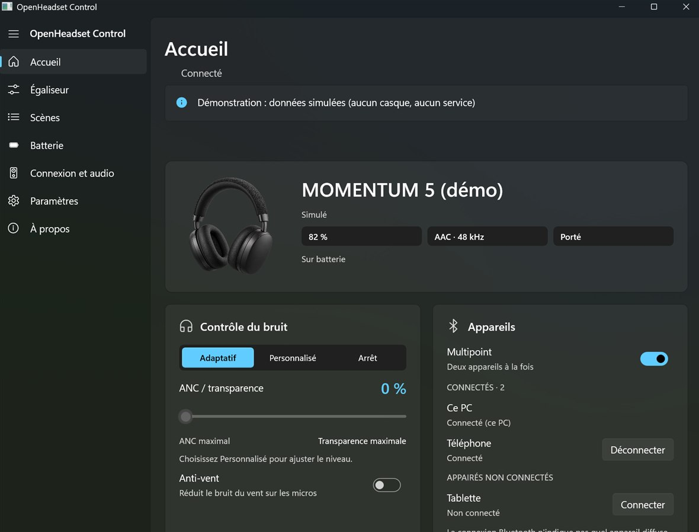
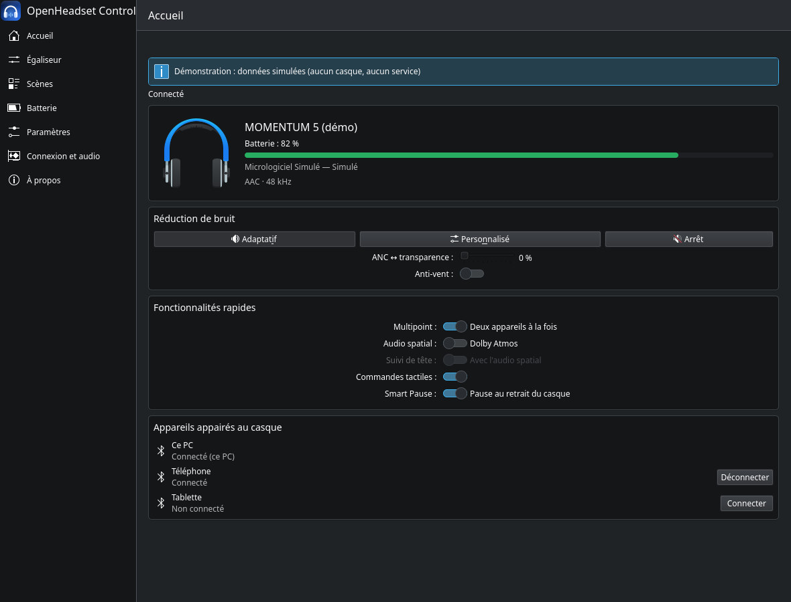
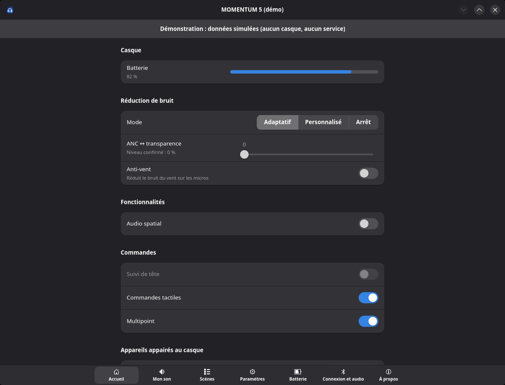

# OpenHeadset Control

**Régler le casque Sennheiser MOMENTUM 5 depuis son PC**, sous Windows 11 et
Linux (KDE Plasma, GNOME), sans l'application mobile Smart Control Plus :
réduction de bruit, égaliseur, scènes, batterie, appels, appareils connectés.
Écrit en Rust, avec une interface native par bureau.

> ⚠️ **Projet non officiel, sans lien avec Sennheiser ni Sonova.** Le protocole
> a été reconstitué à partir de documentation publique et de captures de
> l'application officielle. Seules les commandes capturées puis validées sur le
> casque sont envoyées : **ni** mise à jour du micrologiciel, **ni**
> réinitialisation d'usine, **ni** suppression d'appairage.

| Windows 11 (WinUI 3) | KDE Plasma (Kirigami) | GNOME (libadwaita) |
|---|---|---|
|  |  |  |

Captures en mode démonstration (`--demo` : casque simulé). Toutes les pages :
[docs/INTERFACES.md](docs/INTERFACES.md).

## Fonctions

- **Bruit** : Adaptatif, Personnalisé, Arrêt ; curseur ANC ↔ transparence ;
  anti-vent ; audio spatial et suivi de tête.
- **Son** : égaliseur 8 bandes, amplification des basses, préréglages, courbes
  importées et exportées, comparaison A/B, assistant EQ guidé, Speech Clarity,
  profil personnalisé.
- **Scènes** : un ensemble de réglages en un clic, au raccourci clavier, à la
  connexion du casque ou à heure fixe.
- **Batterie** : niveau, courbe sur 30 jours, autonomie mesurée, avis
  « batterie faible » et « 100 % câble branché ».
- **Appels et confort** : Smart Pause, réponse automatique, appels
  confortables, retour de voix (sidetone), invites, extinction automatique,
  protection de la batterie, nom du casque.
- **Connexions** : appareils appairés au casque, Multipoint, reconnexion ;
  choix du codec Bluetooth sous Linux.
- **Bureau** : icône de la zone de notification et panneau rapide, raccourcis
  globaux, widget Plasma, recherche KRunner, module Waybar (`ctl barre`),
  extension Decky pour le mode jeu, ligne de commande `ctl`.
- **Vie privée** : tout reste sur le PC ; aucun compte, aucune télémétrie. Le
  diagnostic à joindre à un bogue masque nom, adresse et numéro de série.

Chaque réglage affiche l'état **relu sur le casque**, jamais une valeur supposée.

## Installer

Télécharger la dernière version sur la page
[Releases](https://github.com/Asfax03L/momentum-5-control/releases/latest),
avec son empreinte SHA-256 ([vérifier un fichier](docs/VERIFIER.md)) :

| Système | Fichier |
|---|---|
| Windows 10/11 | `…-windows-x86_64-installateur.exe` (par utilisateur, sans droits administrateur ; demande Windows App Runtime 2) |
| Bazzite et autres systèmes en lecture seule | `…-x86_64.flatpak` (`flatpak install --user …`) |
| Debian, Ubuntu | `openheadset-control_…_amd64.deb` |
| Fedora | `openheadset-control-….x86_64.rpm` |
| Autres Linux | archive `…-linux-x86_64.tar.gz`, puis `./installer-linux.sh` |

Le casque doit être appairé et connecté au PC. Le téléphone peut rester
connecté en même temps (Multipoint). Les exécutables ne sont pas signés :
SmartScreen peut demander une confirmation.

Détails, installation depuis les sources et désinstallation :
[docs/INSTALLATION.md](docs/INSTALLATION.md) et [docs/LINUX.md](docs/LINUX.md).

## Compatibilité

| Casque | Micrologiciel | Réglages |
|---|---|---|
| MOMENTUM 5 Wireless (`M5AEBT`) | 6.21.5 | ✅ écritures validées sur le casque, sous Windows 11 et Bazzite 44 |
| MOMENTUM 5, autre micrologiciel | — | 🔒 lecture seule jusqu'à vérification |
| Autres casques GAIA (MOMENTUM 4, ACCENTUM…) | — | 🔒 lecture seule, jamais essayés |

Détail commande par commande : [docs/COMPATIBILITE.md](docs/COMPATIBILITE.md).
Fiche du protocole : [docs/MOMENTUM5.md](docs/MOMENTUM5.md).

## Documentation

| Pour… | Lire |
|---|---|
| Utiliser l'application | [Guide](docs/GUIDE.md) · [FAQ](docs/FAQ.md) · en anglais : [guide](docs/GUIDE.en.md), [FAQ](docs/FAQ.en.md) · [site](https://asfax03l.github.io/momentum-5-control/) |
| Les interfaces en détail | [docs/INTERFACES.md](docs/INTERFACES.md) |
| La ligne de commande | [docs/CTL.md](docs/CTL.md) |
| Linux (Flatpak, paquets, service, Waybar) | [docs/LINUX.md](docs/LINUX.md) |
| Ce qui change à chaque version | [CHANGELOG.md](CHANGELOG.md) · [compatibilité en 1.x](docs/VERSIONS.md) |
| La suite du projet | [docs/ROADMAP.md](docs/ROADMAP.md) |
| Le code | [docs/ARCHITECTURE.md](docs/ARCHITECTURE.md) · [parité des interfaces](docs/PARITE.md) |
| La sécurité | [SECURITY.md](SECURITY.md) · [docs/SECURITE.md](docs/SECURITE.md) |

## Contribuer

Rapports de bogue, de compatibilité et PR sont les bienvenus : voir
[CONTRIBUTING.md](CONTRIBUTING.md). Questions :
[Discussions](https://github.com/Asfax03L/momentum-5-control/discussions).
Une faille de sécurité se signale en privé : [SECURITY.md](SECURITY.md).

## Licence

Au choix [MIT](LICENSE-MIT) ou [Apache-2.0](LICENSE-APACHE). Aucun code tiers
n'est copié : tout est réimplémenté à partir de faits documentés ou observés
([sources](docs/COMPATIBILITE.md#sources)).
