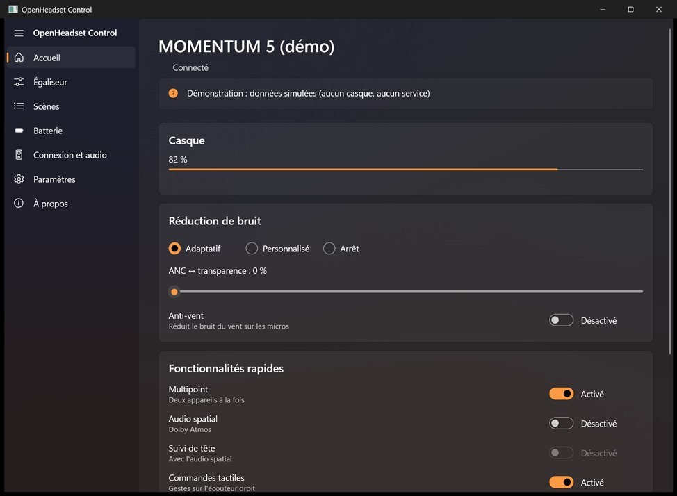
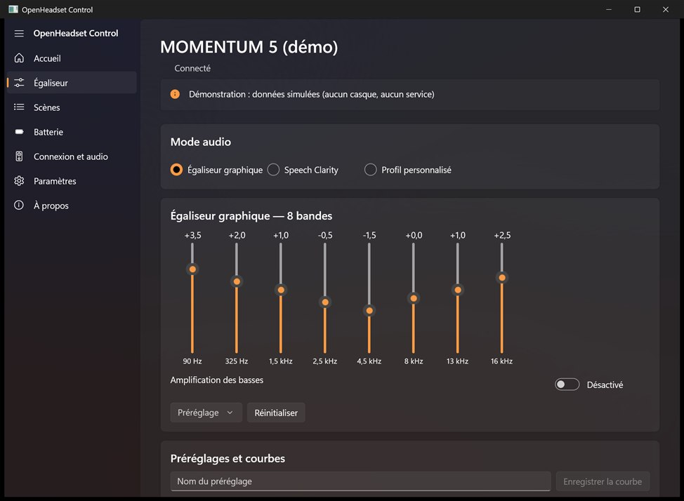
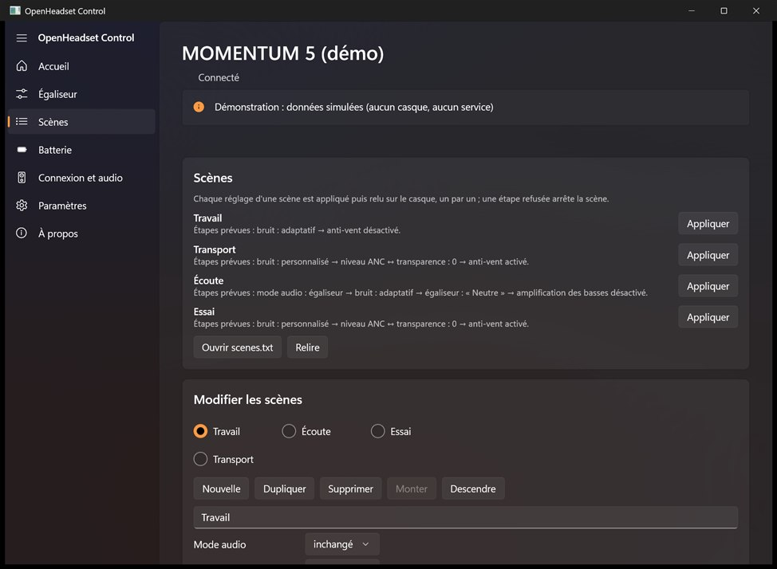
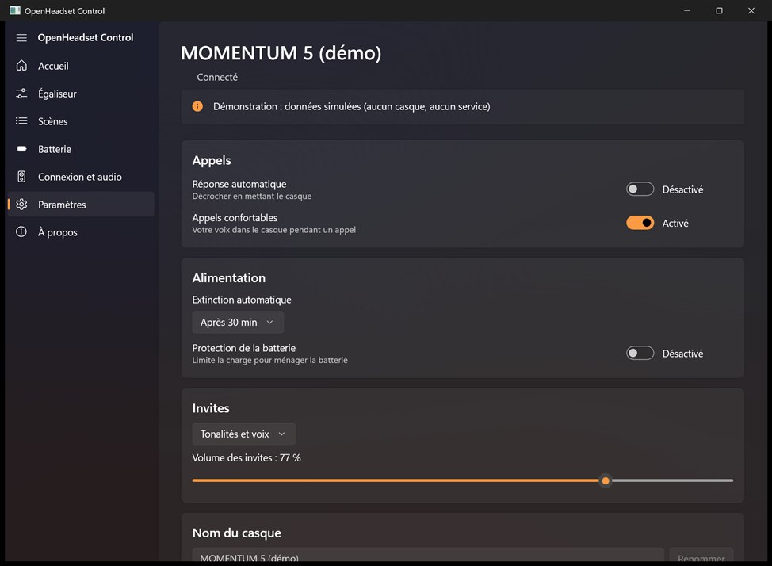
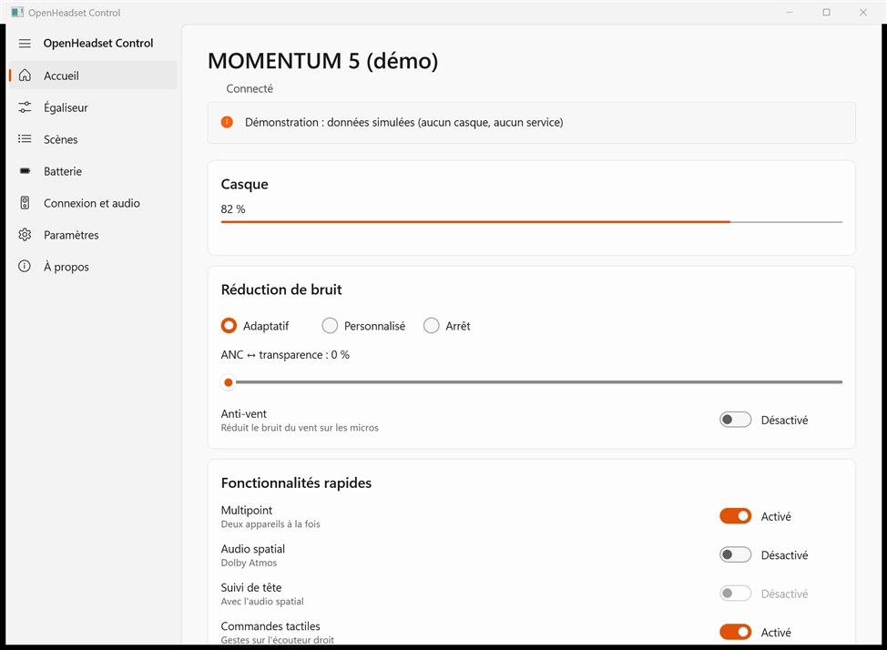
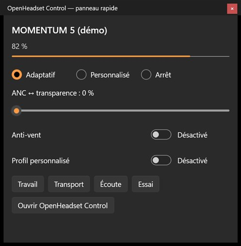
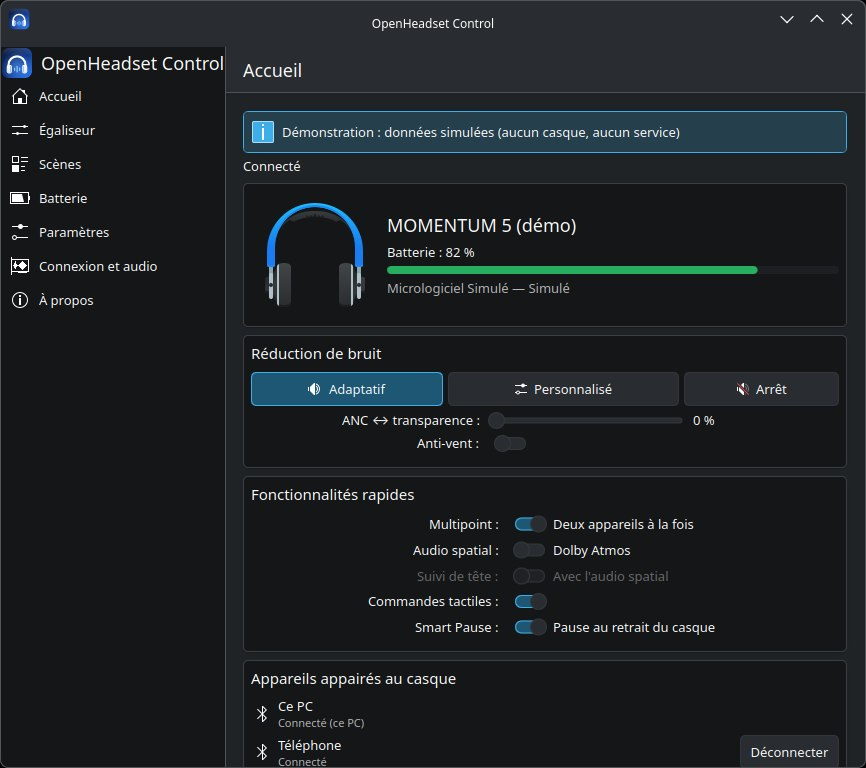
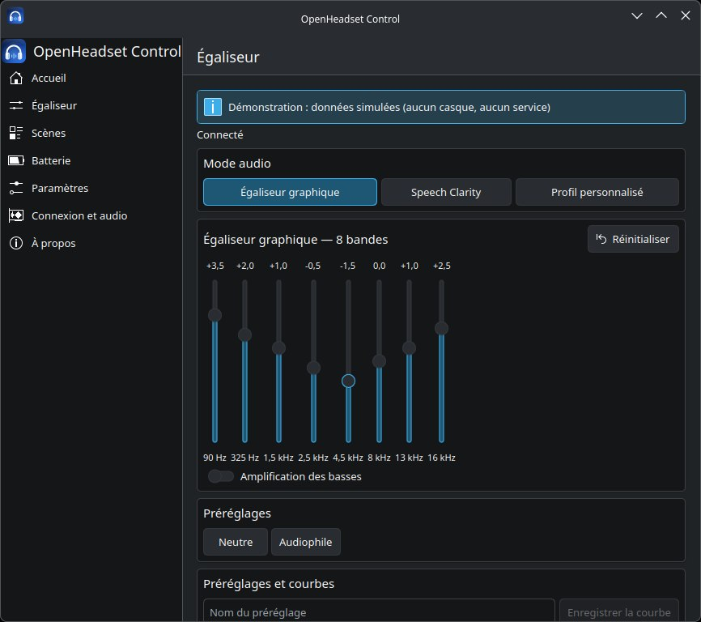
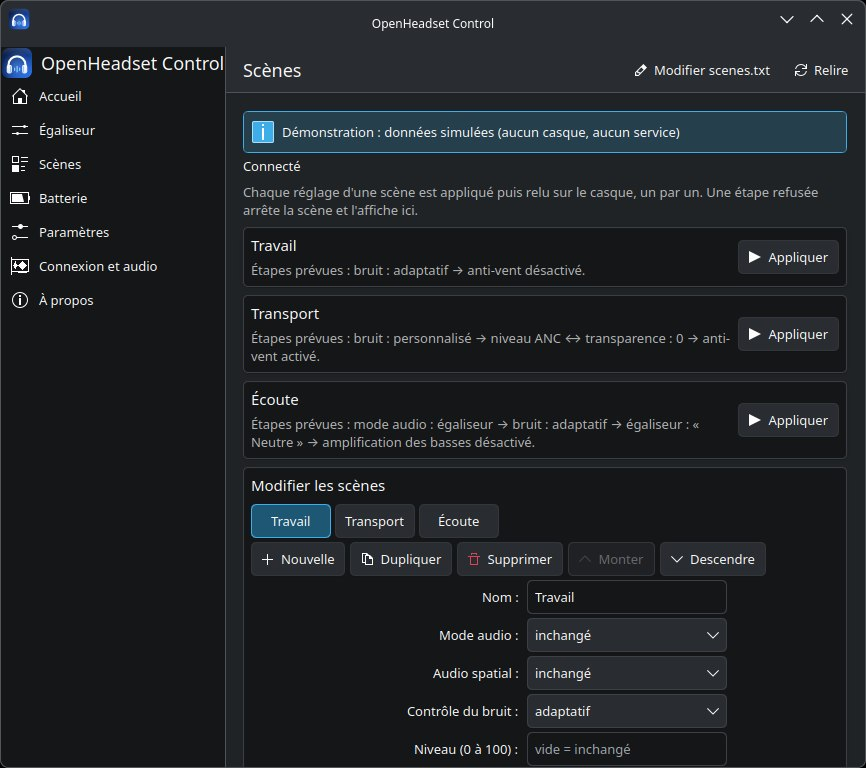
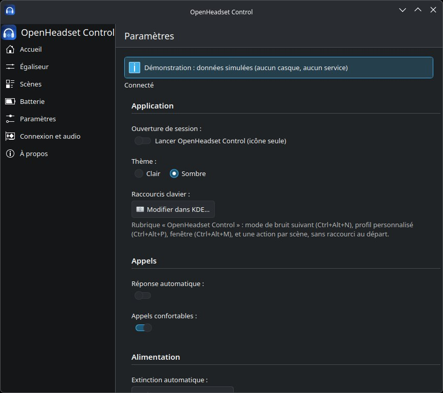

# momentum-ctl-win — OpenHeadset Control


**OpenHeadset Control** : contrôle léger des casques Sennheiser **MOMENTUM 5**
sous Windows 11 et Linux (KDE Plasma, Bazzite ; Wayland natif), en Rust, comme
alternative à l'application mobile Smart Control Plus : une interface
native par système (WinUI 3 sous Windows, Qt 6 / Kirigami sous KDE) avec son
icône dans la zone de notification, un service qui tient seul la connexion
au casque, et deux outils en ligne de commande.

> ⚠️ **Projet non officiel, non affilié à Sennheiser ni à Sonova.** Le protocole
> a été reconstitué à partir de documentation publique et de captures de
> l'application officielle. Utilisation à vos risques. Le projet n'implémente
> **ni** mise à jour du firmware, **ni** réinitialisation d'usine, **ni**
> aucune commande d'écriture qui n'a pas été capturée puis validée sur le
> matériel.

## État du projet

Depuis la **1.4.0**, la page Égaliseur de WinUI et KDE propose un
[assistant EQ guidé](docs/LOT3-ASSISTANT-EQ.md) : trois comparaisons bornées,
copie locale initiale, résultat relu, restauration ou nouveau préréglage.
Aucun son automatique ni profil auditif créé. Le parcours est vérifié en
simulation ; aucune nouvelle séance matérielle n'est revendiquée.

| Phase | Contenu | État |
|---|---|---|
| 1 | Protocole GAIA V3 pur, `MockTransport`, tests sur captures | ✅ |
| 2 | `probe` : diagnostic Bluetooth en lecture seule | ✅ |
| 3 | Réglages du bruit et de l'audio spatial (`ctl`) | ✅ validé sur M5 |
| 4 | Icône dans la barre système, notifications, reconnexion | ✅ validé sur M5 |
| 5 | Fenêtre d'égaliseur | ✅ validé sur M5 |
| A–D | Fenêtre principale complète : Accueil, Mon son, Réglages, À propos | ✅ validé sur M5 |
| E | Raccourcis clavier globaux, notifications Windows, archive publiée | ✅ validé sur le PC (v0.2.0) |
| F | Expériences sur le casque : volume des invites, nom, connexions | ✅ validé sur M5 (v0.3.0) |
| G | Espace de travail Cargo : cœur, service, outils, interfaces séparés | ✅ (v0.7.0) |
| H | Linux : `ctl` et icône par BlueZ, KDE Plasma sous Wayland | ✅ validé sur M5 (v0.7.0) |
| I | Interface OpenHeadset Control (thèmes, disposition adaptative, démo) | ✅ validé sur M5 (v0.7.0) |
| J | Client natif KDE Qt 6 / Kirigami (Linux), logo, entrées de menu ; client du service, icône de la zone de notification, raccourcis KDE | ✅ essayé sur M5 (v0.8.0) |
| K | Service `momentum-daemon` et API D-Bus, `ctl` client du service (Linux) | ✅ essayé sur M5, lecture et écriture (v0.8.0) |
| L | Logo sous Windows : exécutable, menu Démarrer, notifications, icône d'état | ✅ (v0.8.0) |
| M | Service sous Windows (canal nommé) et client WinUI 3 (`windows-reactor`) | ✅ essayé sur M5 (v0.8.0) |
| N | Fonctions de l'icône Slint reprises par WinUI et KDE, puis retrait de Slint | ✅ essayé sur M5 (v0.8.0) |
| O | Consolidation (revue du 21/10) : demandes suivies, identité du casque, installateurs et publication sûrs, Flatpak, widget Plasma | ✅ essayé sur M5 (v0.9.0) |
| P | KDE : panneau rapide, widget Plasma enrichi (demandes suivies, scènes), icône sur zbus 6 | ✅ essayé sur M5 (v0.9.1) |
| Q | Confort et audio Linux : scène depuis l'état, export et import des réglages, reconnexion par le Bluetooth du système, diagnostic PipeWire, `ctl --json`, complétions et `man`, paquets `.deb` et `.rpm` | ✅ essayé sur M5 sous Bazzite (v0.10.0) |
| R | Sécurité et qualité : service Linux durci, provenance et SBOM des publications, `ctl essais`, tests d'interface, couverture, budget de ressources | ✅ suite d'essais rejouée sur M5 (v0.11.0) |
| S | Client GNOME (GTK 4, libadwaita), première étape : page Accueil, demandes suivies, `--demo` ; parité définie avec le client KDE | 🟡 état du M5 lu (v0.12.0) ; écritures essayées en démonstration |
| T | Distribution : Flatpak construit sans réseau (sources figées), identifiant `io.github.asfax03l.openheadset-control`, permissions revues, migration des réglages ; soumission à Flathub préparée | 🟡 installation, mise à jour, migration et désinstallation essayées sur Bazzite (v0.13.0) ; Flathub non soumis |
| U | Paquets natifs : installateur Windows (Inno Setup, par utilisateur), `.deb` et `.rpm` mis à jour par-dessus la version précédente, `PKGBUILD` (AUR), widget `.plasmoid` ; winget, AUR et KDE Store préparés | 🟡 installateur essayé sur Windows 11 avec le M5 (v0.14.0) ; paquets Linux essayés en conteneurs ; catalogues non soumis |
| V | Intégration au bureau : recherche KRunner (« anc off », « scène Transport »), liste de raccourcis Windows (scènes) et pastille de batterie, extension Decky Loader pour le mode jeu ; tout par l'API du service | 🟡 KRunner essayé sur le M5 (Bazzite) et scènes de la liste de raccourcis sur le M5 (Windows 11), v0.15.0 ; extension Decky essayée hors du mode jeu |
| W | Langues et accueil : interfaces en anglais (choix de la langue), accessibilité (noms lus par les lecteurs d'écran, parcours clavier, contrastes), assistant de premier lancement, rapport de bogue prérempli, guide et FAQ, site GitHub Pages | 🟡 vérifié en CI (UI Automation, KDE hors écran) dans les deux langues (v0.16.0) ; écoute au Narrateur et à Orca à faire |
| X | Version stable : politique de versions (`docs/VERSIONS.md`), politique de sécurité (`SECURITY.md`), avis de nouvelle version désactivé par défaut, décisions écrites sur les points ouverts | ✅ v1.0.0 |
| Y | Fonctions avancées : autonomie mesurée (aussi par mode de réduction de bruit), journal local des événements, notifications au choix (dont « casque allumé sans son »), scènes automatiques (connexion, heure fixe), export pour Equalizer APO | ✅ v1.1.0 ; scènes automatiques essayées sur le M5 (Bazzite) |

Version du code : **v1.4.0** (publications sur la page Releases du dépôt), série
stable 1.x. Ce qui reste compatible en 1.x : [`docs/VERSIONS.md`](docs/VERSIONS.md) ;
signaler une faille : [`SECURITY.md`](SECURITY.md). **Guide
d'utilisation et FAQ** : [`docs/GUIDE.md`](docs/GUIDE.md),
[`docs/FAQ.md`](docs/FAQ.md) (en anglais : [`GUIDE.en.md`](docs/GUIDE.en.md),
[`FAQ.en.md`](docs/FAQ.en.md)), aussi sur le site
<https://asfax03l.github.io/openheadset-control/>. Questions :
[Discussions](https://github.com/Asfax03L/openheadset-control/discussions). Le détail des
étapes est dans [`docs/ROADMAP.md`](docs/ROADMAP.md), les nouveautés de chaque
version dans [`CHANGELOG.md`](CHANGELOG.md).

## Limites documentées

L'état physique « porté / non porté » est disponible dans l'état transmis
par l'API du service, distinct de l'activation du capteur et de Smart Pause.
Cette lecture et ses notifications sont couvertes par des tests simulés,
**à valider sur le matériel** depuis le PC ; aucun indicateur graphique
n'est encore ajouté. Voir la [provenance et le contrat](docs/MOMENTUM5.md#état-physique-du-port--observation-complémentaire-du-27102026).

Le protocole du MOMENTUM 5 est décrit dans [docs/MOMENTUM5.md](docs/MOMENTUM5.md) : chaque commande y est marquée validée sur le casque, ou seulement lue. Seules les écritures validées sont envoyées.

## Installation

Prérequis : Windows 10/11 avec Bluetooth, et le casque **appairé et
connecté** au PC (Paramètres > Bluetooth et appareils).

**Sans Rust** : télécharger l'archive de la page Releases du dépôt
(publiée par la CI à chaque étiquette `v*`, avec son empreinte SHA-256,
une attestation de provenance et l'inventaire des dépendances :
[`docs/VERIFIER.md`](docs/VERIFIER.md)) :
sous Windows, l'installateur
`openheadset-control-vX.Y.Z-windows-x86_64-installateur.exe` (par
utilisateur, sans droits administrateur, désinstallation par Paramètres >
Applications) ; sinon l'archive
`openheadset-control-vX.Y.Z-windows-x86_64.zip` ou
`openheadset-control-vX.Y.Z-linux-x86_64.tar.gz`, à décompresser avant de
lancer le script qu'elle contient. Sous Linux, voir aussi le Flatpak, les
paquets `.deb` et `.rpm` et le `PKGBUILD` ([`docs/LINUX.md`](docs/LINUX.md)).
Les exécutables ne sont pas signés : SmartScreen peut demander une
confirmation.

**Windows** (depuis les sources : Rust 1.95 ou plus récent, 1.89 pour la partie
Linux ; version testée figée dans `rust-toolchain.toml`) :

```bash
powershell -ExecutionPolicy Bypass -File scripts\installer.ps1
```

Le script installe, sans droits administrateur, dans
`%LOCALAPPDATA%\Programs\momentum-ctl-win` :
l'interface **WinUI 3** (`momentum-winui.exe`), le service
`momentum-daemon.exe` qu'elle lance au besoin, et `ctl.exe`. Il faut le
Windows App Runtime 2 (le script prévient s'il manque).

Il prend les exécutables posés à côté de lui (archive) ou, à défaut,
compile la version release. Il inscrit l'interface au démarrage de Windows
(elle démarre cachée : l'icône seule), retire l'ancienne icône Slint si
elle est installée, ajoute « OpenHeadset Control » au menu Démarrer et
lance l'interface. Tout est vérifié et préparé avant d'arrêter la version
en place (runtime, fichiers, copie) ; la version remplacée est gardée
(`momentum-ctl-win.ancien`) et remise si l'interface installée ne démarre
pas. Sans Windows App Runtime 2, rien n'est changé (`-SansRuntime` pour
installer quand même). Pour tout retirer :
`scripts\installer.ps1 -Desinstaller`.

**Linux (KDE Plasma)** : sur Bazzite et les systèmes en lecture seule, le
**Flatpak** de la page Releases (`flatpak install --user
openheadset-control-vX.Y.Z-x86_64.flatpak`, détails dans
[docs/LINUX.md](docs/LINUX.md)) ; sinon, depuis l'archive,
`./installer-linux.sh` ; depuis
les sources (voir [docs/LINUX.md](docs/LINUX.md) pour les paquets ; sur
Bazzite, dans une boîte distrobox) :

```bash
cargo build --release -p momentum-cli -p momentum-daemon -p momentum-kirigami
```
```bash
sh scripts/installer-linux.sh
```

Le script installe pour l'utilisateur courant, sans `sudo` : binaires dans
`~/.local/bin`, logo dans le thème d'icônes, entrées « OpenHeadset Control »
dans le menu des applications (KDE y trouve aussi l'icône des fenêtres sous
Wayland), service avec son unité systemd utilisateur et son activation
D-Bus. Le client Kirigami demande Qt 6 et Kirigami (présents sous KDE).
L'ancienne icône Slint (`momentum-tray`), si elle est installée, est retirée.
Un fichier manquant arrête le script avant tout changement ; les binaires
remplacés sont gardés (`*.ancien`) et remis si une copie échoue. Pour tout
retirer : `sh scripts/installer-linux.sh --desinstaller` (réglages, scènes
et historique gardés).

Pour un simple essai sans installation (Windows) :

```bash
cargo run --release --bin momentum-winui
```

L'icône d'un casque apparaît près de l'horloge (au besoin, dans les icônes
cachées, flèche **^**). Avec `--page son` (ou `scenes`, `batterie`, `audio`,
`reglages`, `apropos`), la fenêtre s'ouvre sur cette page ; avec `--cache`,
elle démarre cachée (l'icône seule). Le téléphone peut rester connecté au
casque en même temps : le M5 accepte le PC en multipoint.

## Interfaces OpenHeadset Control

Trois interfaces natives, clientes du service `momentum-daemon` qui tient
seul la connexion au casque :

- **Windows** : `momentum-winui`, en WinUI 3 (fond Mica, contrôles Fluent) ;
- **KDE Plasma** : `momentum-kirigami`, en Qt 6 / Kirigami (couleurs du
  thème Plasma, Wayland natif) ;
- **GNOME** : `momentum-gtk`, en GTK 4 / libadwaita, encore partielle (page
  Accueil ; rattrapage prévu dans [`docs/PARITE.md`](docs/PARITE.md)).

S'y ajoutent `ctl`, le widget Plasma, la recherche KRunner, la liste de
raccourcis Windows et l'extension Decky du mode jeu, tous clients du même
service.

Elles offrent les mêmes fonctions et partagent les mêmes fichiers de
réglages (`scenes.txt`, `raccourcis.txt`, `prereglages.txt`,
`panneau.txt`, `apparence.txt`, `batterie.csv`).

Captures en mode démonstration (`--demo` : casque simulé, valeurs
fictives).

**Windows 11 (WinUI 3)**

| Accueil | Égaliseur |
|---|---|
|  |  |
| **Scènes** | **Paramètres** |
|  |  |
| **Thème clair** | **Panneau rapide** (clic sur l'icône) |
|  |  |

**KDE Plasma (Qt 6 / Kirigami)**

| Accueil | Égaliseur |
|---|---|
|  |  |
| **Scènes** | **Paramètres** |
|  |  |

- **Pages** : **Accueil** (batterie, modes de bruit, curseur ANC ↔
  transparence, anti-vent, audio spatial et suivi de tête, appareils
  appairés au casque avec Connecter / Déconnecter sauf ce PC, Multipoint
  avec confirmation), **Égaliseur** (mode audio : égaliseur, Speech Clarity
  ou profil personnalisé ; 8 bandes ; préréglages de l'app et les vôtres ;
  export et import de courbes ; comparaison A/B ; export du profil dans
  Documents), **Scènes** (boutons et éditeur), **Batterie**, **Connexion et
  audio**, **Paramètres**, **À propos**.
- **Rien n'est présenté comme appliqué avant la réponse du casque** : un
  réglage affiche l'état relu, et un refus est signalé dans un bandeau.
- **Construites d'après le casque** : nombre de bandes, plage de
  l'égaliseur et réglages disponibles viennent des lectures ; un réglage
  non lu est affiché comme indisponible.
- **Paramètres** : Smart Pause, réponse automatique, appels confortables,
  extinction automatique, protection de la batterie, invites et volume des
  invites, nom du casque, commandes tactiles ; langue des invites et
  priorité du mode audio en lecture seule ; thème **clair ou sombre**
  (gardé dans `apparence.txt` ; sans choix, celui du système ; sous KDE
  Plasma, jeu de couleurs Breeze clair ou sombre pour l'application seule) ; contenu du panneau rapide ;
  éditeur des raccourcis clavier globaux.
- **Batterie** : courbe sur 24 h, 7 ou 30 jours (fichier local
  `batterie.csv`, export CSV, effacement confirmé) ; les périodes sans
  mesure restent vides, et ni état de charge, ni santé, ni cycles ne sont
  inventés.
- **Connexion et audio** : état de la liaison, heure des dernières lectures
  et vérification de la sortie audio du système en lecture seule : Windows,
  ou PipeWire sous KDE (profil Bluetooth, codec et sortie par défaut du
  casque piloté). Le codec du casque en Multipoint reste une source distincte.
- **À propos** : modèle, micrologiciel, révision matérielle, et
  **diagnostic expurgé** à copier dans un rapport de bogue (ni nom, ni
  adresse Bluetooth, ni numéro de série, ni chemin personnel, ni profil
  auditif ; affiché avant toute copie, rien n'est envoyé). « Signaler un
  problème… » ouvre le formulaire de bogue GitHub prérempli avec ce
  diagnostic, après relecture ; l'envoi se fait sur GitHub. Le guide et
  l'assistant de premier lancement s'y rouvrent.
- **Langue** : français ou anglais selon le système, ou au choix dans les
  Paramètres (au prochain lancement) ; `ctl` et le diagnostic restent en
  français.
- **Accessibilité** : noms lus par les lecteurs d'écran, parcours complet
  au clavier, titres annoncés ; vérifiés en CI
  (`scripts/audit-accessibilite-winui.ps1`, test `accessibilite_qml`).
- **Mode démonstration** : `--demo` montre l'interface avec un casque
  simulé, sans service ni Bluetooth (bandeau « Démonstration : données
  simulées » permanent ; aucun fichier de l'utilisateur n'est modifié).

### Widget Plasma

Sous KDE Plasma, un widget à poser sur le panneau ou le bureau (« Ajouter
des composants graphiques » > OpenHeadset Control) : batterie, mode de
réduction de bruit, curseur ANC ↔ transparence, anti-vent, audio spatial,
suivi de tête, profil personnalisé, scènes du panneau rapide et bouton
d'ouverture de la fenêtre. C'est un client de l'API D-Bus du service
(`org.openheadset.Control1`), en QML seul : il n'envoie que les commandes de
l'API, que le service vérifie, n'affiche que l'état relu, et montre le
résultat de chaque réglage (« appliqué et relu », refus…). Il ne démarre
pas le service de lui-même (bouton « Démarrer le service »). Installé par
`installer-linux.sh` ; avec le Flatpak, l'installer depuis l'archive :

```bash
kpackagetool6 --type Plasma/Applet --install plasma/org.openheadset.control.plasmoid
```

### Icône de la zone de notification

- **Clic gauche** : sous Windows, panneau rapide près de l'horloge
  (batterie, modes de bruit, curseur, profil, scènes ; contenu choisi dans
  les Paramètres) ; sous KDE, le même panneau (contenu choisi dans la page
  Scènes), placé par KWin.
- **Clic droit** : mode de bruit, curseur ANC ↔ transparence en 5 crans,
  anti-vent, audio spatial, Speech Clarity, profil personnalisé,
  Égaliseur…, réglages du casque, scènes, lancement à l'ouverture de
  session, Quitter.
- **Infobulle et couleur** : nom du casque, batterie, mode actuel ; bleu =
  ANC, vert d'eau = adaptatif, orange = transparence, gris clair =
  désactivé, gris = déconnecté.
- **Raccourcis clavier globaux** (éditeur des Paramètres, ou fichier
  `raccourcis.txt` ; une scène s'écrit `scene:Nom = Ctrl+Alt+1`) :
  **Ctrl+Alt+N** mode de bruit suivant, **Ctrl+Alt+P** profil personnalisé
  ou égaliseur, **Ctrl+Alt+M** ouvrir la fenêtre. Sous KDE, ils sont
  enregistrés auprès de KGlobalAccel et modifiables dans la Configuration
  du système.
- **Notifications** (par le service) : batterie faible (une fois sous
  15 %, réarmée au-dessus de 20 %), casque déconnecté, puis reconnecté.
- **Une seule instance** : relancer l'application montre la fenêtre de
  l'instance déjà lancée ; fermer la fenêtre la cache seulement.
- **Journal du service** : `momentum-daemon.log` dans le dossier des
  données (`%LOCALAPPDATA%\momentum-ctl-win` sous Windows ; archivé en
  `.old.log` au-delà de 1 Mo). Ni nom de casque ou d'appareil, ni adresse
  aux niveaux ordinaires (`info`, `warn`, `debug` : contenus de plus de
  3 octets masqués). Le niveau `trace` (`RUST_LOG=trace`, à activer
  volontairement) écrit les trames brutes, noms et adresses compris : ce
  journal-là ne se partage pas.

### Égaliseur

8 bandes (90 Hz, 325 Hz, 1,5 kHz, 2,5 kHz, 4,5 kHz, 8 kHz, 13 kHz, 16 kHz ;
de −6 à +6 dB), Amplification des basses et « Remettre à plat ». Chaque
gain est relu après l'envoi : la fenêtre affiche toujours l'état réel du
casque et suit aussi les changements faits sur le téléphone. Les
préréglages de l'app (Rock, Jazz…) n'existent que dans l'app : pour le
casque, un préréglage n'est qu'une suite de 8 gains.

### Scènes

Une scène applique plusieurs réglages d'un coup (« Transport » : ANC maximal
et anti-vent, par exemple). Elles se créent dans l'éditeur de la page
Scènes, ou dans le fichier `scenes.txt` du dossier des données, créé avec
trois exemples (Travail, Transport, Écoute) au premier lancement :

```ini
[Transport]
bruit = personnalise
niveau = 0
anti-vent = on
```

Réglages possibles : `son` (egaliseur, voix, profil), `spatial`, `bruit`
(adaptatif, personnalise, arret), `niveau` (0 à 100), `anti-vent`, `tactile`,
`egaliseur` (nom d'un préréglage) et `basses`. Uniquement des réglages déjà
validés sur le M5 : ni priorité du mode audio, ni langue, ni connexions. Une
scène incohérente (niveau sans mode Personnalisé, égaliseur sans
`son = egaliseur`, audio spatial avec le profil…) est refusée avec le numéro
de ligne. Les réglages partent un par un dans un ordre fixe ; ce n'est pas
une transaction : à la première erreur, l'application s'arrête et le rapport
dit ce qui a été appliqué. Accès : page Scènes, sous-menu « Scènes » de
l'icône, raccourcis, `ctl scene <nom>`.

Depuis la 1.1, une scène peut s'appliquer seule : `auto = connexion` (à
chaque connexion du casque) ou `auto = 08:30` (chaque jour à cette heure,
si le casque est connecté), une scène par déclenchement ; liste
« Automatique » de l'éditeur. Le service note chaque application dans le
journal des événements, et signale une scène automatique incomplète.

Pour mémoriser les réglages déjà lus, saisir un nom puis cliquer sur
« Enregistrer l'état actuel comme scène » dans la page Scènes (WinUI ou
KDE), ou utiliser le service en ligne de commande :

```sh
ctl scene-enregistrer "Écoute démo"
ctl --json scene-enregistrer "Écoute démo" --remplacer
```

Cette opération écrit seulement les fichiers locaux, sans commande vers le
casque ni nouvelle lecture Bluetooth. Elle exige un état connu du service ;
sans lui, elle échoue sans connexion directe. Les valeurs non lues restent
absentes. Le curseur n'est conservé qu'en mode Personnalisé, et la courbe
et les basses seulement en mode égaliseur ; la courbe devient un préréglage
personnel portant le nom de la scène dans `prereglages.txt`.

Un nom existant est refusé, sauf avec `--remplacer` (ou la case de
remplacement dans la fenêtre). Les autres scènes, les autres préréglages
et les commentaires sont conservés ; les fichiers remplacés ont leur
sauvegarde `.bak`. Un état incohérent ou un fichier de scènes invalide est
refusé avant l'enregistrement. L'éditeur de scènes garde son éventuel
brouillon en cours.

### Sauvegarder et retrouver mes réglages

Les pages Paramètres de WinUI et de Kirigami proposent un sélecteur pour
exporter les réglages ou examiner une sauvegarde avant de confirmer son
import. Ces opérations fonctionnent sans casque ni service. En ligne de
commande :

```powershell
ctl reglages exporter mes-reglages.json
ctl reglages importer mes-reglages.json --simulation
ctl reglages importer mes-reglages.json
```

La sauvegarde JSON porte `version: 1` et une table `fichiers` contenant les
textes exacts de `scenes.txt`, `prereglages.txt`, `raccourcis.txt`,
`panneau.txt` et `apparence.txt`, commentaires compris. Un fichier absent
est représenté par `null` ; à l'import, il laisse le fichier destinataire
intact. Les noms de fichier inconnus et les versions inconnues sont refusés.
Aucun profil auditif, export de profil, identifiant d'appareil ou fichier
extérieur à cette liste n'est lu.

L'export refuse toujours d'écraser sa destination. Pour inclure
`batterie.csv`, ajouter explicitement `--avec-batterie` à l'export et à
l'import, ou cocher l'option correspondante dans l'interface. Sans cette
option d'import, l'historique présent dans une sauvegarde est signalé puis
ignoré. `--json` fonctionne aussi avec les commandes de réglages.

L'import valide **tous** les textes avant toute écriture, y compris les
lignes que les analyseurs d'affichage ignoreraient. `--simulation` décrit
les créations et remplacements sans créer de fichier ni de dossier. Les
fichiers remplacés sont conservés sous `nom.txt.ancien` (ou
`batterie.csv.ancien`) ; une sauvegarde `.ancien` existante doit être
conservée ailleurs avant un nouvel import qui modifierait ce même fichier.
Un fichier identique n'est pas réécrit. Un changement local depuis l'aperçu
refuse la confirmation et demande une nouvelle simulation. Les remplacements
utilisent des fichiers temporaires et une restauration est tentée en cas
d'erreur ; ils ne constituent pas une transaction atomique entre fichiers.

Les raccourcis restent au format de `raccourcis.txt` sous les deux systèmes.
Sous KDE, un avertissement rappelle de les configurer dans Paramètres
système > Raccourcis : l'import ne modifie pas la configuration KDE.
Enregistrer les brouillons avant l'export et relancer l'interface après
l'import pour recharger tous les réglages. Limites : 2 Mio par texte et
16 Mio pour le JSON complet.

### Reconnecter le casque

Quand le casque est déconnecté, le bouton « Reconnecter le casque » est
proposé dans l'Accueil et le menu de l'icône WinUI/Kirigami, ainsi que dans
le widget Plasma. La commande équivalente est `ctl reconnecter` (aussi
`ctl --json reconnecter`). Le service est requis : aucun accès RFCOMM
direct de secours.

Le casque doit avoir été mémorisé par le service lors d'une précédente
connexion validée (`casque.txt`, empreinte seulement). Sans cela, la demande
est refusée avec une explication. Linux demande à BlueZ de connecter cet
appareil déjà appairé. Sous Windows, les paramètres Bluetooth s'ouvrent :
sélectionner le casque puis **Connecter**. L'application ne prétend pas
forcer la connexion audio sous Windows.

Le résultat suivi indique une **demande système**, jamais un réglage GAIA
appliqué ni un audio confirmé. Attendre ensuite que le service affiche le
casque connecté et vérifier la sortie audio dans « Connexion et audio ».
En cas d'échec ou de délai dépassé, vérifier les paramètres Bluetooth avant
de réessayer ; aucune répétition automatique de cette action. Aucun
appairage ni réglage explicite de profil, routage ou casque n’est modifié. La connexion
Bluetooth elle-même peut activer les profils auto-connectables du système.
Essai de reconnexion sur matériel : à valider par le mainteneur.

### `ctl` et le service

Quand le service `momentum-daemon` tourne (lancé par l'interface, ou par
activation D-Bus sous Linux), `ctl` passe par lui : il reste seul à tenir
la connexion GAIA. Sans service, `ctl` se connecte lui-même au casque.

## Ligne de commande : `ctl`

> **Linux** : `ctl` passe par le service, ou se connecte lui-même par
> BlueZ. Voir [docs/LINUX.md](docs/LINUX.md).

```bash
cargo run --release --bin ctl -- etat
```
```bash
cargo run --release --bin ctl -- mode adaptatif
```
```bash
cargo run --release --bin ctl -- niveau 50
```
```bash
cargo run --release --bin ctl -- bande 8 -2.5
```

Sous-commandes : `etat [--json]`, `scenes`, `scene <nom>`,
`mode arret|adaptatif|personnalise`, `niveau <0-100>`
(0 = ANC max, 50 = neutre, 100 = transparence max), `anti-vent on|off`,
`spatial on|off`, `eq`, `bande <1-8> <dB>`, `plat`, `basses on|off`,
`nom [nouveau]`, `connexions`, `connecter <n>`, `deconnecter <n>`,
`suivi-tete on|off` (audio spatial activé), `multipoint on|off`,
`volume-invites <0-100>`, `voix on|off` (Speech Clarity), `profil on|off` (profil de personnalisation
du son déjà enregistré), `tactile on|off`, `protection-batterie on|off`,
`smart-pause on|off`, `reponse-auto on|off`, `appels-confort on|off`,
`extinction jamais|15|30|60`, `invites tonalites|voix`. Chaque réglage reproduit à l'octet près les trames de Smart
Control Plus, puis l'état est relu : `ctl` échoue si le casque ne l'a pas
appliqué.

`exporter-profil <fichier.json>` sauvegarde en lecture seule le profil de
personnalisation du son : octets bruts des blocs `2003`/`2005`/`2007`,
date, modèle, firmware, état `2001` et mode audio bruts, empreinte. Ni numéro
de série ni adresse Bluetooth, mais le profil est une donnée auditive
personnelle : ne pas publier ce fichier. Sous Linux, le service (unité
durcie, [`docs/SECURITE.md`](docs/SECURITE.md)) n'écrit que dans
`~/Documents`. Un fichier existant n'est jamais
écrasé, et aucune restauration n'est proposée.

### Sortie JSON pour les scripts

`--json` est global : `ctl --json etat` et `ctl etat --json` sont
équivalents. La sortie standard contient **un seul objet JSON**, en version
`1` ; les messages humains et les journaux restent sur stderr. Un échec
donne `ok: false`, `erreur` et un code de sortie non nul, y compris en cas
d'arguments invalides. Sans cette option, l'affichage reste textuel.

- `etat` conserve exactement son format historique (ordre des champs
  compris) : `connecte`, `batterie`, `bruit`, etc.
- `eq` renvoie `egaliseur` (gains et bornes en **dixièmes de dB**, et
  `basses`) ; `connexions` renvoie `connexions` (nom, `connecte`, `ce_pc`,
  sans adresse ni identifiant opaque) ; `nom` sans argument renvoie `nom`.
- `scenes` renvoie la liste des noms valides dans `scenes` et les erreurs
  de lecture ou d'analyse du fichier dans `avertissements`, sans service
  ni casque.
- Les réglages et `exporter-profil` renvoient `ok`, `etat` (valeurs relues),
  `resultat` (issue donnée par le service, si disponible) et `details`
  (rapport d'une scène ou fichier exporté, si disponible).

Dans le champ `etat` des réponses aux réglages, les valeurs non relues
sont `null` : batterie, bruit, audio
spatial, suivi de tête, mode audio, statut du profil, protection de la
batterie, commandes tactiles, Smart Pause, réponse automatique, appels
confortables, extinction en secondes, mode des invites, codec, fréquence,
égaliseur, connexions, nom, Multipoint et volume des invites en pourcentage.
Les clés exactes sont documentées dans
[`momentum_core::json`](crates/momentum-core/src/json.rs).
Une relecture partielle reste partielle : `niveau` en connexion directe
relit le bruit, pas toute la batterie ni l'égaliseur. Le JSON n'ajoute
aucune commande au casque et ne réessaie pas une écriture.

Une lecture absente vaut `null`, une liste effectivement lue et vide vaut
`[]`. Le service ne distingue pas encore une liste de connexions vide
d'une liste non lue : elle est donc rendue par `null` dans ce cas. Un
acquittement conserve `resultat: "accepté par le casque"` et les champs
non relus à `null` ; il ne devient pas une confirmation d'application.
Les codes du service sont conservés : `0` succès, `1` refus ou annulation,
`2` non appliqué, `3` résultat inconnu. Les autres erreurs d'exécution
sortent avec `1` ; les arguments invalides avec `2`.

Exemple shell (avec `jq` pour lire le résultat) :

```sh
if resultat=$(ctl --json mode adaptatif); then
    printf '%s\n' "$resultat" | jq -r '.etat.bruit.mode'
else
    printf '%s\n' "$resultat" | jq -r '.erreur' >&2
fi
```

Exemple Stream Deck, dans une action de **lanceur de commande** : choisir
`ctl` comme exécutable et `--json scene Travail` comme arguments. Le
lanceur peut récupérer stdout pour lire `ok`, `etat` et `details`, et le
code de sortie pour signaler l'échec. La scène reste définie dans
`scenes.txt` et applique les mêmes réglages que `ctl scene Travail`.

Avec `--json`, `man`, `completions`, l'aide et la version sont encapsulés
dans un objet `version`, `type`, `contenu`. Pour installer directement un
script de complétion ou un manuel, utiliser les commandes sans `--json`.

### Suite d'essais sur le casque

Avant chaque publication, `ctl essais` rejoue les essais faits à la main :
pour chaque réglage validé (niveau, anti-vent, bande 1, basses, tactile,
Smart Pause, réponse automatique, appels confortables, extinction,
invites, volume des invites, Speech Clarity), une autre valeur est écrite
et relue, puis la valeur d'origine est remise et relue. La première
anomalie arrête la suite, après une tentative de remise. Jamais : nom,
multipoint, connexions, profil personnalisé, langue, priorité du mode
audio. Service requis.

```bash
ctl essais --simulation
```
```bash
ctl essais --rapport essais-casque.md
```

`--liste niveau,anti-vent` choisit les essais ; `--json` rend un objet avec
chaque résultat et le compte rendu. Le compte rendu Markdown (date,
version, système, modèle, micrologiciel) ne contient ni nom, ni adresse,
ni numéro de série. Code de sortie 1 en cas d'anomalie.

### Complétion et manuel

`ctl completions <shell>` écrit un script sur la sortie standard pour
`bash`, `zsh`, `fish`, `powershell` ou `elvish`. `ctl man` écrit la page
`ctl.1` au format roff. Ces deux commandes fonctionnent sans casque ni
service et utilisent la même définition Clap que les commandes de réglage.

```bash
# Activer la complétion bash dans le shell courant.
source <(ctl completions bash)
# Consulter le manuel généré sans l'installer.
ctl man > ctl.1
man -l ./ctl.1
```

L'archive Linux contient `man/ctl.1` et les complétions bash, zsh et fish.
`installer-linux.sh` les installe sans sudo dans les dossiers suivants
(sous `$XDG_DATA_HOME`, ou `~/.local/share` par défaut) :

- `man/man1/ctl.1` : consultable avec `man ctl` ;
- `bash-completion/completions/ctl` : chargé par bash-completion ;
- `zsh/site-functions/_ctl` : ajouter ce dossier à `fpath` avant `compinit` ;
- `fish/vendor_completions.d/ctl.fish` : chargé par fish.

Pour zsh, placer dans `~/.zshrc`, avant un éventuel appel existant à
`compinit` :

```zsh
fpath=("${XDG_DATA_HOME:-$HOME/.local/share}/zsh/site-functions" $fpath)
autoload -Uz compinit
compinit
```

Si `man` ne trouve pas le dossier utilisateur, utiliser
`man -M "${XDG_DATA_HOME:-$HOME/.local/share}/man" ctl`. Depuis les sources,
l'installateur génère ces fichiers avec `target/release/ctl` avant toute
copie ; depuis l'archive, il vérifie leur présence avant l'installation.

## Diagnostic : `probe`

```bash
cargo run --release --bin probe -- --all-gets --output rapport.txt
```

| Option | Effet |
|---|---|
| `--device <nom>` | filtre sur le nom (par défaut « momentum » ou « sennheiser ») |
| `--service <UUID>` | service RFCOMM à utiliser si aucun ne s'appelle « GAIA » |
| `--all-gets` | envoie aussi les autres GET documentés (modèle, firmware, codec, bruit…) |
| `--deep` | inventaire complet en lecture seule : réglages, égaliseur, appareils appairés au casque, features Qualcomm |
| `--output <fichier>` | enregistre aussi le rapport |
| `--verbose` | journal détaillé sur stderr (trames brutes) |
| `--show-address` | affiche adresses Bluetooth et numéro de série (masqués par défaut) |
| `--timeout-ms <n>` | délai d'attente de chaque réponse (3000 par défaut) |

Le rapport liste les appareils appairés, les services RFCOMM (avec attributs
SDP bruts) et GATT, puis chaque échange `TX` / `RX` en hexadécimal avec son
interprétation. Les fichiers `rapport*.txt` sont ignorés par git : ils
contiennent les noms de vos appareils.

## Compatibilité MOMENTUM 5

### Modèles et micrologiciels testés

| Casque (modèle lu) | Micrologiciel | Systèmes essayés | Écritures |
|---|---|---|---|
| MOMENTUM 5 Wireless (`M5AEBT Black`) | 6.21.5 | Windows 11 ; Bazzite 44 (KDE Plasma 6, Wayland) | ✅ validées (tableau ci-dessous) |
| MOMENTUM 5, autre micrologiciel | — | — | 🔒 lecture seule (non vérifié) |
| Autre casque GAIA (ACCENTUM, MOMENTUM 4…) | — | jamais essayé | 🔒 lecture seule |

Un autre modèle ou micrologiciel reste en lecture seule (aucun réglage
envoyé) tant que chaque écriture n'y a pas été vérifiée. Pour en signaler
un, ouvrez une issue « Compatibilité » avec la sortie de `probe --deep`
(voir [CONTRIBUTING.md](CONTRIBUTING.md)).

### Détail des commandes

Relevé sur un M5 « M5AEBT Black », firmware 6.21.5, en octobre 2026.
Transport : Bluetooth Classic RFCOMM, service SDP « GAIA »
(UUID `A2129FF3-081B-4C45-8AFE-469D9C4842EC`). Windows n'a joint aucun
service GATT (ce qui ne prouve pas qu'il n'en existe aucun).

| Fonctionnalité | Commande | Validée sur M5 ? |
|---|---|---|
| Connexion RFCOMM GAIA (en parallèle du téléphone) | — | ✅ |
| Lire batterie, modèle, firmware, codec | `0603`, `1206`, `1201`, `0800` | ✅ |
| Lire le mode Adaptatif / Personnalisé / ARRÊT | `1A05` + `1A01` | ✅ |
| Lire le curseur ANC ↔ transparence | `1A03` | ✅ 0 = ANC max, 50 = neutre, 100 = transparence max |
| Lire anti-vent, audio spatial | `1A01` (paire 1), `3605` | ✅ |
| Lire l'égaliseur et l'Amplification des basses | `1000`, `1002 [bande]`, `1009` | ✅ 8 bandes, ±6 dB |
| Lire Smart Pause, port, appels, invites, extinction auto… | voir la fiche | ✅ (`probe --deep`) |
| Changer le mode | `1A04` + `1A00 [03 x]` | ✅ |
| Régler le curseur ANC ↔ transparence | `1A02 [0-100]` | ✅ |
| Activer / désactiver l'anti-vent | `1A00 [01 x]` | ✅ |
| Activer / désactiver l'audio spatial | `3604 [0/1]` | ✅ |
| Notifications (batterie, bruit, audio spatial, égaliseur) | `0495:0007 [feature]` | ✅ |
| Régler une bande de l'égaliseur | `1001 [bande, gain]` | ✅ |
| Activer / désactiver l'Amplification des basses | `1008 [0/1]` | ✅ |
| Speech Clarity (mode audio) | `0803 [00, 02]` ; égaliseur : `[00, 01]` | ✅ |
| Commandes tactiles | `1606 [1 = désactivées]`, lecture `1607` | ✅ |
| Protection de la batterie | `060A [0/1]`, lecture `060B` | ✅ |
| Smart Pause, réponse automatique, appels confortables | `080C`, `080A`, `0814` `[0/1]` | ✅ |
| Extinction automatique | `0600 [00, secondes u16]` | ✅ jamais / 15 / 30 / 60 min |
| Invites (tonalités / tonalités et voix) | `0801 [1/2]` | ✅ |
| Volume des invites | `081C [i8]` (−20 à +6), lecture `081D` | ✅ validé sur M5 (échelle relevée, `ctl volume-invites`) |
| Nom du casque | `2801 [nom]`, lecture `2802` | ✅ validé sur M5 (`ctl nom`, page Réglages ; ASCII, 32 caractères au plus) |
| Gestion des connexions : connecter, déconnecter un appareil appairé | `140F` / `1410 [adresse]`, liste `140D`/`140E`, ce PC `1413` | ✅ validé sur M5 (`ctl connexions`, Accueil) ; suppression d'un appairage et Multipoint non exposés |
| Suivi de tête (Dolby Atmos) | `3602 [0/1]`, lecture `3603` | ✅ validé sur M5 (`ctl suivi-tete`, audio spatial activé) |
| Multipoint | `001D:0E00 [0/1]`, lecture `0495:1409` (1 ou 2 connexions) | ✅ validé sur M5 (`ctl multipoint` ; le couper ne garde qu'un appareil) |
| Langue des invites | lecture `0807` | 🟡 lecture seule : changer de langue télécharge et installe un pack de voix (non fait) |
| Détection de port (désactivation) | `0400` ? | ➖ non capturé : désactive aussi 3 autres fonctions |
| Priorité du mode audio (haute résolution, sans perte) | `0405`/`0407` puis redémarrage `060F` | 🟡 lecture seule : le redémarrage bloque souvent l'app du téléphone (voir la fiche) |
| Gestes (personnalisation) | — | ➖ non personnalisables sur le M5 (indiqué par l'app) |
| Retrouver le casque, Zones sonores | — | ➖ fonctions de l'app (position du téléphone), rien côté casque |
| Personnalisation du son : sélection du profil existant | `0803 [00 03]` (après `3604 [00]` si Dolby Atmos) | ✅ validé sur M5 (capture HCI + relecture PC) |
| Personnalisation du son : lecture et export du profil | `2001`, `2003`…`2007` | ✅ lu par `probe --deep`, exporté brut par `ctl exporter-profil` (identique octet pour octet) |
| Personnalisation du son : nouveau test, écriture du profil, persistance | `2000`…`2006` | 🟡 capturé, non exposé (voir la fiche) |

Fiche détaillée (méthode, trames, séquence de démarrage de l'app, pistes) :
[docs/MOMENTUM5.md](docs/MOMENTUM5.md).

## Architecture

Espace de travail Cargo. Le cœur et le service ne dépendent d'aucune
bibliothèque d'interface ; chaque interface vit dans `frontends/` (voir
[frontends/README.md](frontends/README.md)). Direction choisie : un service
qui tient seul le casque et des interfaces natives clientes (WinUI 3 sous
Windows, Kirigami sous KDE), tout en Rust — voir
[docs/ARCHITECTURE.md](docs/ARCHITECTURE.md).

```
crates/momentum-core/      protocole, casque, scènes, modèles d'affichage (sans interface)
  src/protocol/            trames GAIA V3 : encodage, décodage de flux, interprétation
  src/transport/           trait Transport + MockTransport + RFCOMM WinRT (Windows) / BlueZ (Linux)
  src/client.rs            requête → réponse, réception des notifications
  src/device.rs            couche casque : état, réglages validés, notifications
  src/viewmodel.rs, ui.rs  modèles d'affichage et libellés, communs à toutes les interfaces
  tests/                   captures vérifiées (ACCENTUM/M4 et M5)
crates/momentum-service/   worker (seul propriétaire de la connexion), notifications,
                           raccourcis, démarrage auto et instance unique (Windows)
crates/momentum-client/    API du service : Command, Event, Snapshot ; client D-Bus / canal nommé
crates/momentum-daemon/    momentum-daemon : le service (D-Bus sous Linux, canal nommé sous Windows)
crates/momentum-cli/       ctl (réglages en ligne de commande), probe (diagnostic en lecture seule)
frontends/winui/           momentum-winui : interface WinUI 3 (Windows)
frontends/kirigami/        momentum-kirigami : interface Qt 6 / Kirigami (KDE Plasma)
scripts/                   installer.ps1, installer-linux.sh (installation utilisateur)
```

Choix principaux :

- **Un seul propriétaire de la connexion** : le service ; les interfaces
  et `ctl` lui envoient des commandes et reçoivent l'état et les
  événements, donc une seule connexion GAIA.
- **Pas de Tokio sous Windows** : les appels WinRT sont bloqués dans un
  thread dédié au casque, qui communique avec le service par un canal
  `mpsc`.
- **Écritures uniquement capturées** : chaque commande d'écriture provient
  d'une capture de l'app officielle, puis est validée sur le casque.
- **Écritures réservées au M5 en micrologiciel validé** : à la connexion,
  le nom de modèle (`1206`) puis le micrologiciel (`1201`) sont lus ; si le
  modèle ne commence pas par `M5AEBT` ou si le micrologiciel n'est pas
  6.21.5 (le seul sur lequel les écritures ont été vérifiées), le service et
  `ctl` passent en lecture seule (aucune trame de réglage envoyée) et le
  bandeau en donne la raison. Un nouveau micrologiciel est ajouté après
  vérification de chaque écriture.
- **Délais maximaux** : recherche du casque, connexion et envoi ont chacun un
  délai (10 s, 15 s, 5 s) ; une pile Bluetooth figée ne bloque pas le
  service.

## Sources

- [PROTOCOL.md de Oein/sennheiser-desktop-client](https://github.com/Oein/sennheiser-desktop-client/blob/main/PROTOCOL.md)
  (analyse de Smart Control, vérifiée sur ACCENTUM Wireless).
- Relevés sur un M5 réel : `probe --deep`, relevé croisé avec l'app via ADB,
  capture du journal HCI Bluetooth d'Android (détails dans la fiche).
- Aucun code tiers n'est copié : tout est réimplémenté à partir des faits
  documentés ou observés.

## Contribuer

Rapports de bogue, de compatibilité et PR sont les bienvenus : voir
[CONTRIBUTING.md](CONTRIBUTING.md) (règles du projet, vérifications avant
une PR). Une faille de sécurité se signale en privé (avis de sécurité
GitHub) : voir [`docs/SECURITE.md`](docs/SECURITE.md).

## Licence

Code du projet : au choix [MIT](LICENSE-MIT) ou [Apache-2.0](LICENSE-APACHE).

