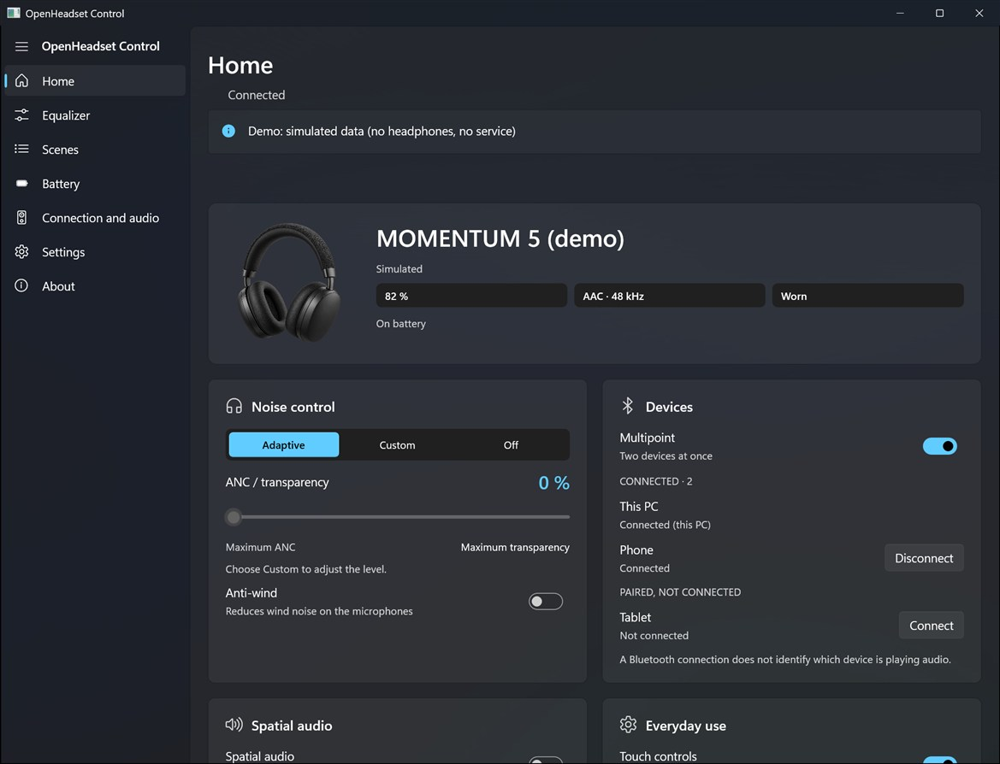
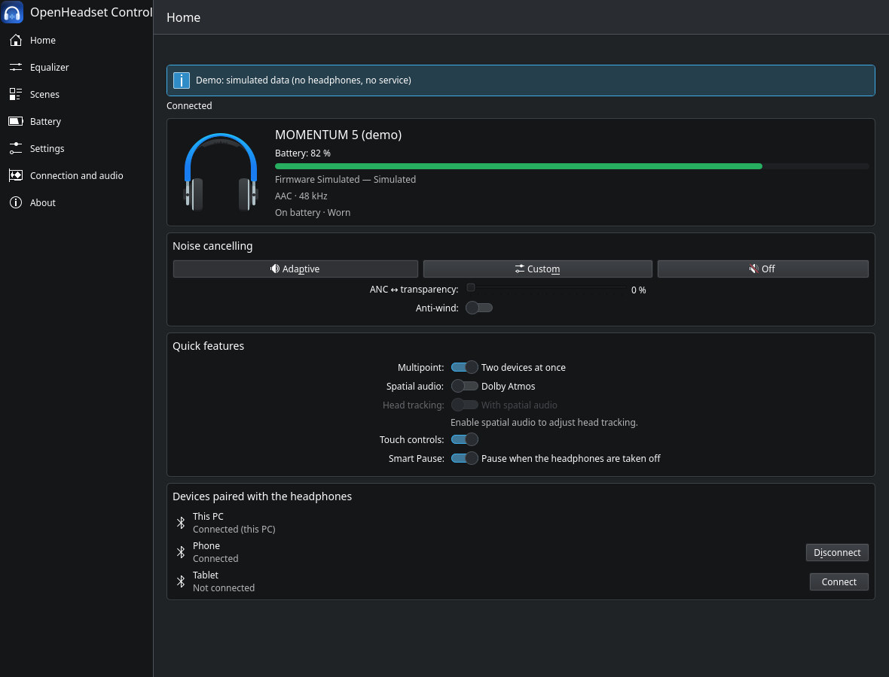
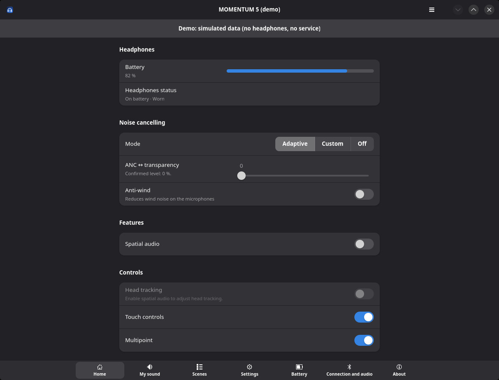

<div align="center">


# OpenHeadset Control

**Control your Sennheiser MOMENTUM 5 headphones from your PC.**<br>
Noise control, equalizer, scenes and battery on Windows 11 and Linux, without the phone app.

[](https://github.com/Asfax03L/momentum-5-control/actions/workflows/ci.yml)
[](https://github.com/Asfax03L/momentum-5-control/releases/latest)
[](https://github.com/Asfax03L/momentum-5-control/releases)
[](#install)
[](#license)

**English** · [Français](README.fr.md)

[**Download**](https://github.com/Asfax03L/momentum-5-control/releases/latest) ·
[User guide](docs/GUIDE.en.md) ·
[FAQ](docs/FAQ.en.md) ·
[Website](https://asfax03l.github.io/momentum-5-control/en/) ·
[Discussions](https://github.com/Asfax03L/momentum-5-control/discussions)

</div>

> [!IMPORTANT]
> **Unofficial project, not affiliated with Sennheiser or Sonova.** The protocol
> was reconstructed from public documentation and from captures of the official
> app. Only commands that were captured and then validated on the headphones are
> sent. The app never updates the firmware, never does a factory reset and never
> removes a pairing.

| Windows 11 · WinUI 3 | KDE Plasma · Kirigami | GNOME · libadwaita |
|---|---|---|
|  |  |  |

<sub>Screenshots taken in demo mode (`--demo`: simulated headphones). Every page of
the three apps: [docs/INTERFACES.md](docs/INTERFACES.md) (in French).</sub>

## Why OpenHeadset Control

- **A native app on each desktop.** WinUI 3 on Windows, Kirigami on KDE Plasma,
  libadwaita on GNOME. One Rust core and one background service behind all of them.
- **You see what the headphones report.** Each setting shows the value read back
  from the headphones, never an assumed one.
- **Private.** No account, no telemetry. Everything stays on your PC. The
  diagnostic you attach to a bug report hides names, addresses and the serial number.
- **Careful by design.** A command is sent only after it was captured in the
  official app and validated on real headphones. Anything else stays read-only.

## Features

| | |
|---|---|
| 🎧 **Noise** | Adaptive, Custom and Off modes, ANC ↔ transparency slider, anti-wind, spatial audio and head tracking |
| 🎚️ **Sound** | 8-band equalizer, bass boost, presets, curve import and export, A/B comparison, guided EQ assistant, Speech Clarity, personal sound profile |
| 🎬 **Scenes** | A set of settings applied in one click, by a keyboard shortcut, when the headphones connect, or at a fixed time |
| 🔋 **Battery** | Level, 30-day chart, measured battery life, “low battery” and “100 % while plugged in” notices |
| 📞 **Calls and comfort** | Smart Pause, auto-answer, comfort calls, sidetone, voice prompts, auto power-off, battery protection, headphones name |
| 🔗 **Connections** | Devices paired with the headphones, Multipoint, reconnection, Bluetooth codec choice on Linux |
| 🖥️ **Desktop** | Tray icon and quick panel, global shortcuts, Plasma widget, KRunner search, Waybar module, Decky plugin for game mode, `ctl` command line |
| 🌍 **Languages** | English and French, in every app |

## Install

Download the latest version from the
[Releases page](https://github.com/Asfax03L/momentum-5-control/releases/latest).
Each file comes with its SHA-256 checksum ([how to verify a file](docs/VERIFIER.md), in French).

| System | File |
|---|---|
| Windows 10/11 | `…-windows-x86_64-installateur.exe` — per-user installer, no administrator rights; needs Windows App Runtime 2 |
| Bazzite and other read-only systems | `…-x86_64.flatpak` — `flatpak install --user …` |
| Debian, Ubuntu | `openheadset-control_…_amd64.deb` |
| Fedora | `openheadset-control-….x86_64.rpm` |
| Other Linux | `…-linux-x86_64.tar.gz`, then `./installer-linux.sh` |

The headphones must be paired with the PC and connected. Your phone can stay
connected at the same time (Multipoint). The executables are not code-signed:
Windows SmartScreen may ask you to confirm.

Step by step, from source, and how to uninstall:
[docs/INSTALLATION.en.md](docs/INSTALLATION.en.md).

## Compatibility

| Headphones | Firmware | Settings |
|---|---|---|
| MOMENTUM 5 Wireless (`M5AEBT`) | 6.21.5 | ✅ Writes validated on the headphones, on Windows 11 and Bazzite 44 |
| MOMENTUM 5, other firmware | — | 🔒 Read-only until verified |
| Other GAIA headphones (MOMENTUM 4, ACCENTUM…) | — | 🔒 Read-only, never tried |

Command by command: [docs/COMPATIBILITE.en.md](docs/COMPATIBILITE.en.md).
Do you own another model or firmware? A
[compatibility report](https://github.com/Asfax03L/momentum-5-control/issues/new/choose)
helps a lot.

## Command line

Everything the apps do is also available from a terminal:

```bash
ctl etat                 # state: battery, noise mode, codec…
ctl mode adaptatif       # noise mode: arret | adaptatif | personnalise
ctl niveau 50            # 0 = max ANC, 50 = neutral, 100 = max transparency
ctl scene Travail        # apply a scene
ctl --json etat          # one JSON object, for scripts
```

The command names are French words. The full list:
[docs/CTL.md](docs/CTL.md) (in French), or `ctl --help`.

## Documentation

| Topic | English | Français |
|---|---|---|
| Using the app | [Guide](docs/GUIDE.en.md) · [FAQ](docs/FAQ.en.md) | [Guide](docs/GUIDE.md) · [FAQ](docs/FAQ.md) |
| Installation | [INSTALLATION.en.md](docs/INSTALLATION.en.md) | [INSTALLATION.md](docs/INSTALLATION.md) |
| Compatibility | [COMPATIBILITE.en.md](docs/COMPATIBILITE.en.md) | [COMPATIBILITE.md](docs/COMPATIBILITE.md) |
| Contributing | [CONTRIBUTING.md](CONTRIBUTING.md) | [CONTRIBUTING.fr.md](CONTRIBUTING.fr.md) |
| Security policy | [SECURITY.md](SECURITY.md) | [SECURITY.fr.md](SECURITY.fr.md) |
| The apps, page by page | — | [INTERFACES.md](docs/INTERFACES.md) |
| Linux: Flatpak, packages, service, Waybar | — | [LINUX.md](docs/LINUX.md) |
| Command line | — | [CTL.md](docs/CTL.md) |
| Protocol notes for the MOMENTUM 5 | — | [MOMENTUM5.md](docs/MOMENTUM5.md) |
| Architecture | — | [ARCHITECTURE.md](docs/ARCHITECTURE.md) |
| Changelog and roadmap | — | [CHANGELOG.md](CHANGELOG.md) · [ROADMAP.md](docs/ROADMAP.md) |

The project is written in French first. Release notes, code comments and the
technical documents are in French; questions and issues in English are welcome.

## Build from source

You need Rust (the tested version is pinned in `rust-toolchain.toml`).

```bash
# Windows: the WinUI app, in demo mode (no headphones needed)
cargo run --release --bin momentum-winui -- --demo
```

```bash
# Linux: service, command line, KDE app and GNOME app
cargo build --release -p momentum-daemon -p momentum-cli -p momentum-kirigami -p momentum-gtk
```

The Linux apps need Qt 6 with Kirigami (KDE) and GTK 4 with libadwaita (GNOME).
Details: [docs/INSTALLATION.en.md](docs/INSTALLATION.en.md).

## Contributing

Bug reports, compatibility reports and pull requests are welcome, in English or
in French: see [CONTRIBUTING.md](CONTRIBUTING.md). Questions go to
[Discussions](https://github.com/Asfax03L/momentum-5-control/discussions).
Please report a security issue privately: [SECURITY.md](SECURITY.md).

## License

Your choice of [MIT](LICENSE-MIT) or [Apache-2.0](LICENSE-APACHE). No
third-party code is copied: everything is reimplemented from documented or
observed facts ([sources](docs/COMPATIBILITE.en.md#sources)).

Sennheiser and MOMENTUM are trademarks of their respective owners. This project
is independent and is not endorsed by them.
