# Interfaces

Ce que montrent les interfaces WinUI, KDE et GNOME, le widget Plasma et l'icône de la zone de notification.
Pas à pas pour l'utilisateur : [GUIDE.md](GUIDE.md).


Trois interfaces natives, clientes du service `momentum-daemon` qui tient
seul la connexion au casque :

- **Windows** : `momentum-winui`, en WinUI 3 (fond Mica, contrôles Fluent) ;
- **KDE Plasma** : `momentum-kirigami`, en Qt 6 / Kirigami (couleurs du
  thème Plasma, Wayland natif) ;
- **GNOME** : `momentum-gtk`, en GTK 4 / libadwaita : mêmes pages que le client
  KDE, avec panneau rapide et raccourcis globaux (1.7.0) ; avec le casque, l'affichage
  des vraies valeurs est essayé, pas encore les changements depuis l'interface ([`docs/PARITE.md`](PARITE.md)).

S'y ajoutent `ctl`, le widget Plasma, la recherche KRunner, la liste de
raccourcis Windows et l'extension Decky du mode jeu, tous clients du même
service.

WinUI et KDE offrent les mêmes fonctions ; les trois interfaces partagent les
mêmes fichiers de réglages (`scenes.txt`, `raccourcis.txt`, `prereglages.txt`,
`panneau.txt`, `apparence.txt`, `batterie.csv`).

Captures en mode démonstration (`--demo` : casque simulé, valeurs
fictives).

**Windows 11 (WinUI 3)**

| Accueil | Égaliseur |
|---|---|
| 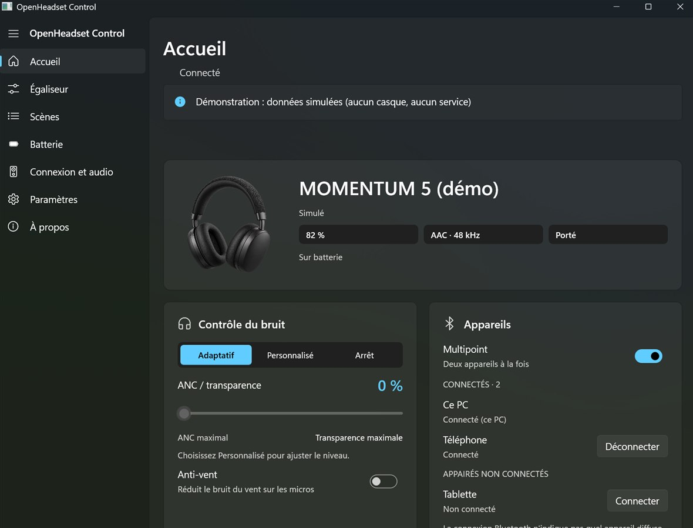 | 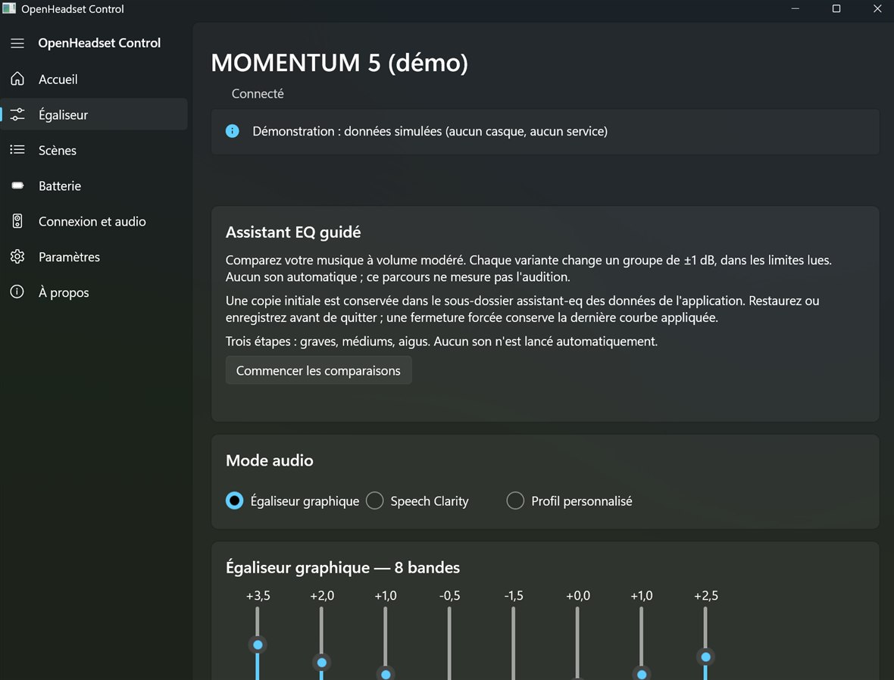 |
| **Scènes** | **Paramètres** |
| 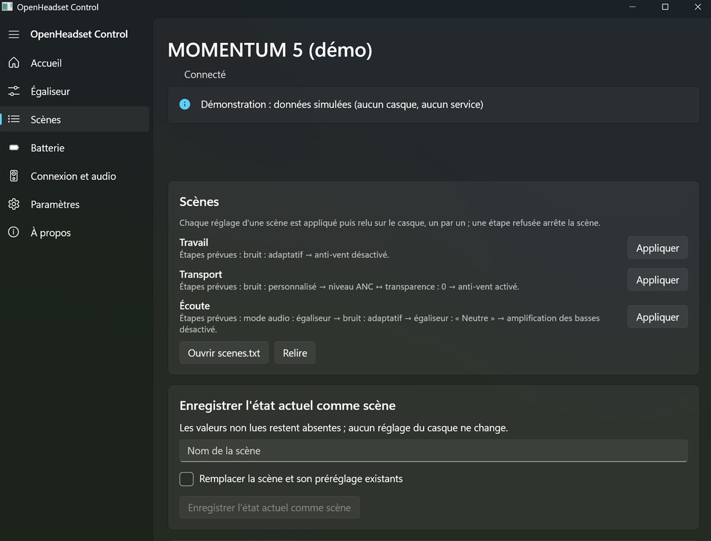 | 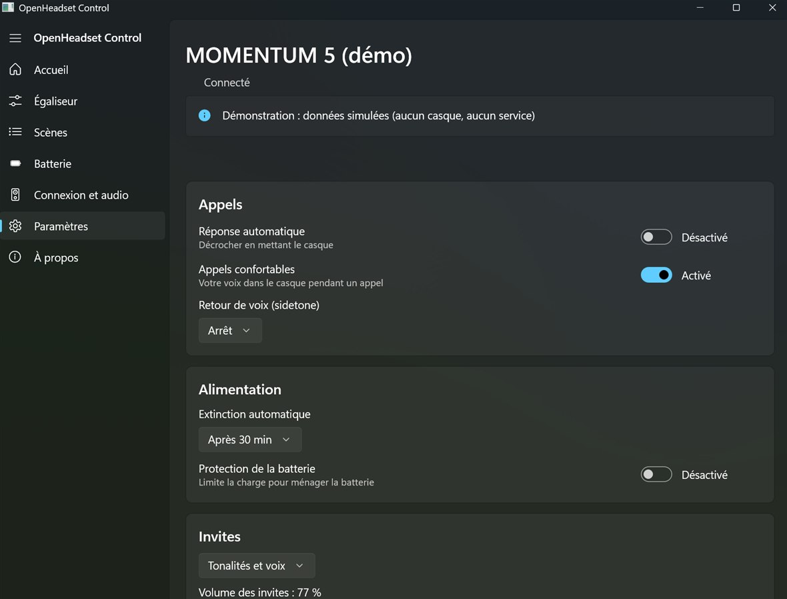 |
| **Thème clair** | **Panneau rapide** (clic sur l'icône) |
| 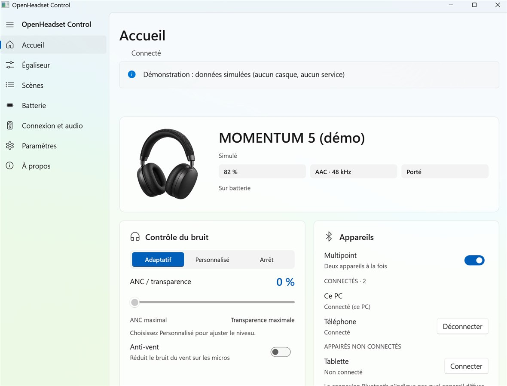 | 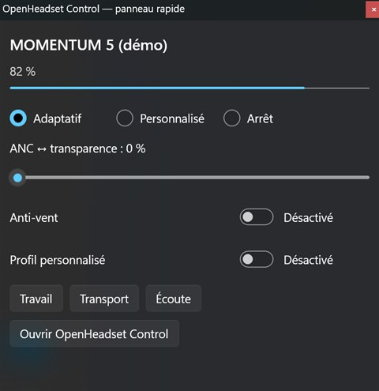 |

**KDE Plasma (Qt 6 / Kirigami)**

| Accueil | Égaliseur |
|---|---|
| 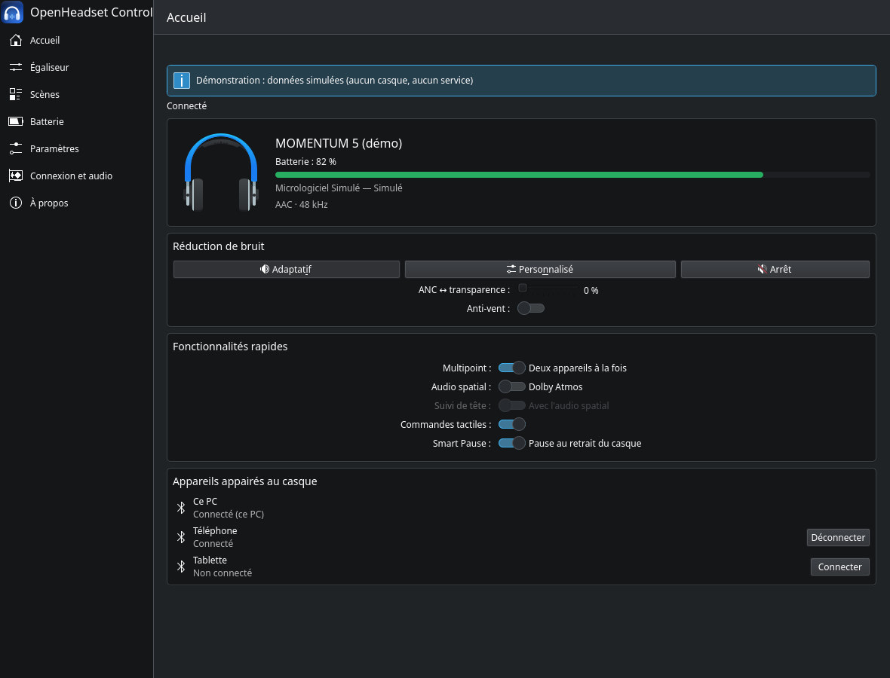 | 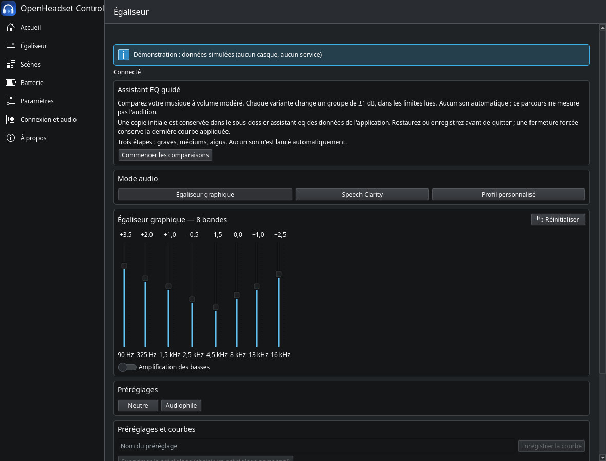 |
| **Scènes** | **Paramètres** |
| 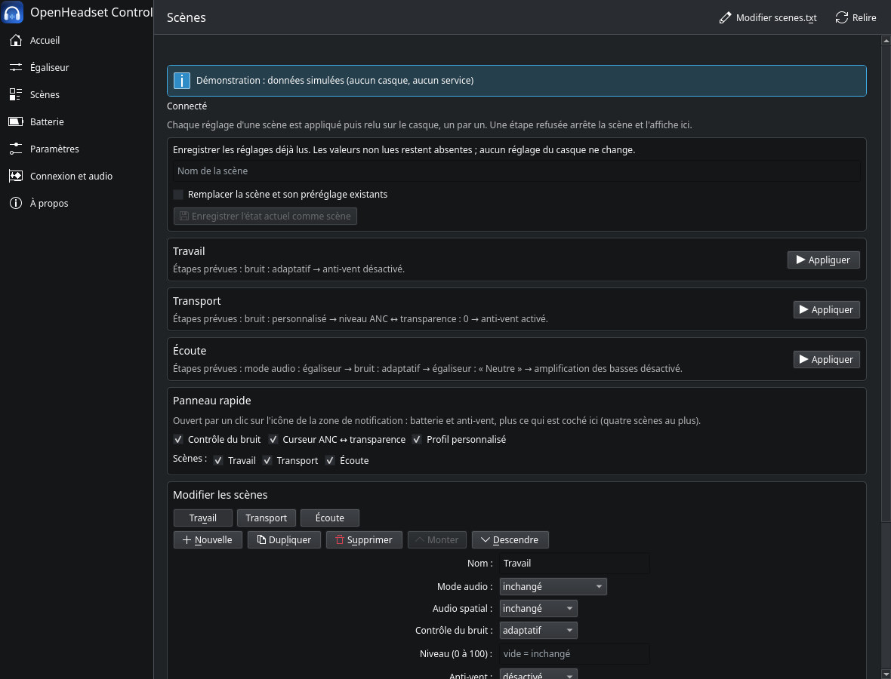 | 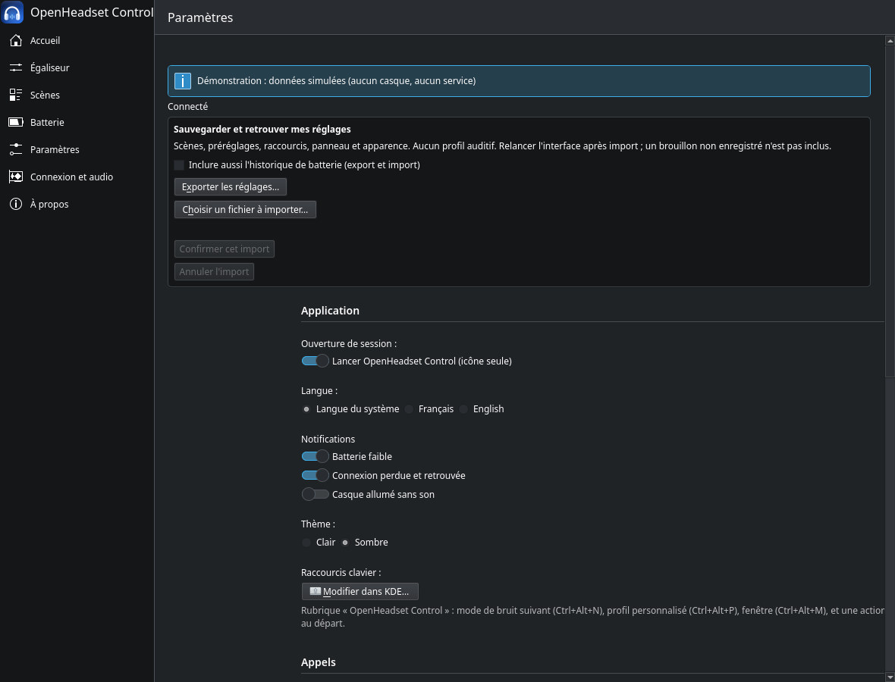 |

**GNOME (GTK 4 / libadwaita)**

| Accueil | Égaliseur |
|---|---|
| 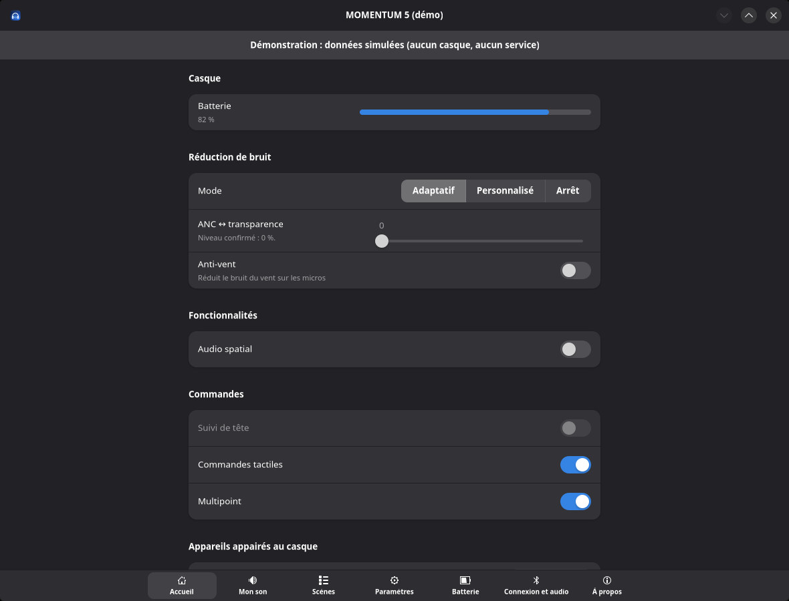 | 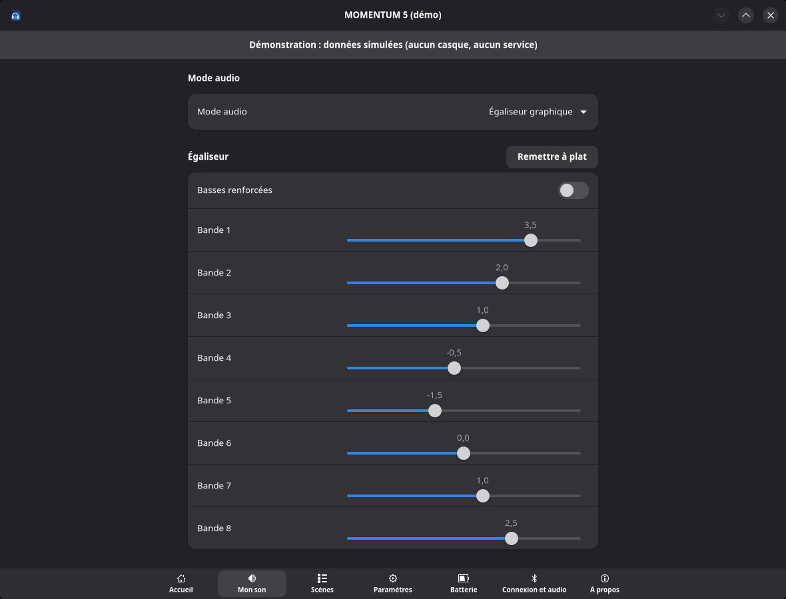 |
| **Scènes** | **Paramètres** |
| 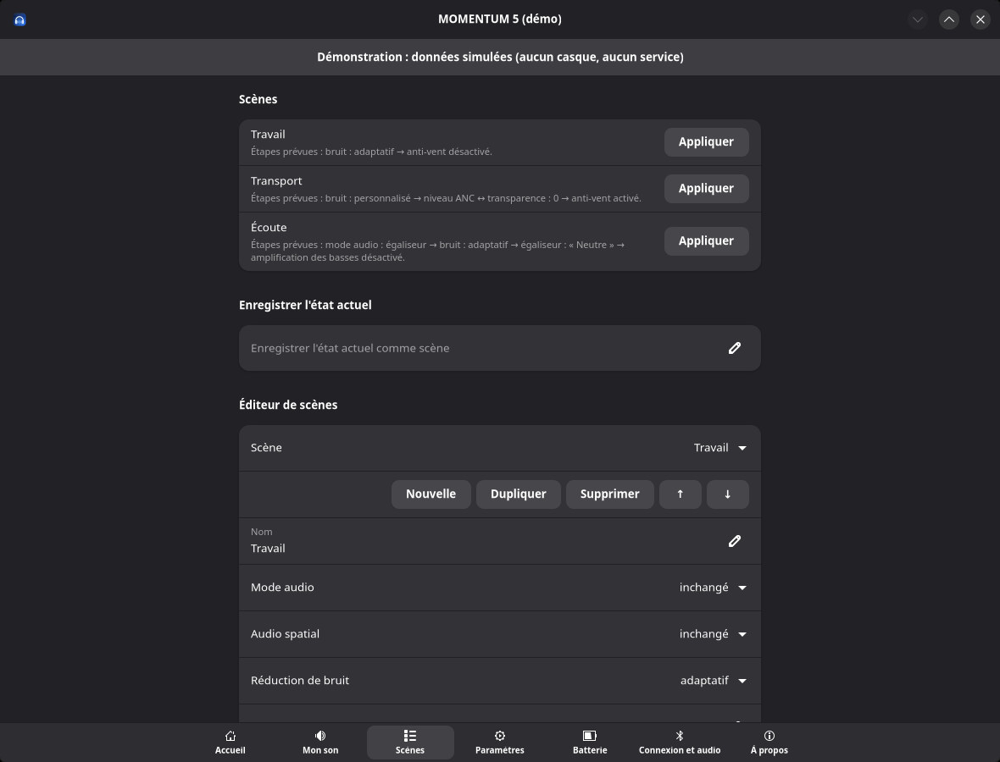 | 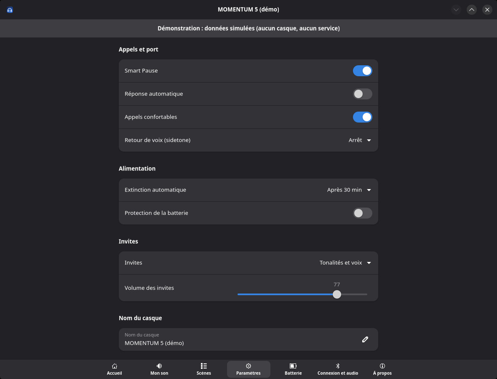 |

- **Pages** : **Accueil** (batterie, modes de bruit, curseur ANC ↔
  transparence, anti-vent, audio spatial et suivi de tête, appareils
  appairés au casque avec Connecter / Déconnecter sauf ce PC, Multipoint
  avec confirmation), **Égaliseur** (mode audio : égaliseur, Speech Clarity
  ou profil personnalisé ; 8 bandes ; préréglages de l'app et les vôtres ;
  export et import de courbes ; comparaison A/B ; export du profil dans
  Documents), **Scènes** (boutons et éditeur), **Batterie**, **Connexion et
  audio**, **Paramètres**, **À propos**.
- **Rien n'est présenté comme appliqué avant la réponse du casque** : un
  réglage affiche l'état relu, et un refus est signalé dans un bandeau.
- **Construites d'après le casque** : nombre de bandes, plage de
  l'égaliseur et réglages disponibles viennent des lectures ; un réglage
  non lu est affiché comme indisponible.
- **Paramètres** : Smart Pause, réponse automatique, appels confortables,
  extinction automatique, protection de la batterie, invites et volume des
  invites, nom du casque, commandes tactiles ; langue des invites et
  priorité du mode audio en lecture seule ; thème **clair ou sombre**
  (gardé dans `apparence.txt` ; sans choix, celui du système ; sous KDE
  Plasma, jeu de couleurs Breeze clair ou sombre pour l'application seule) ; contenu du panneau rapide ;
  éditeur des raccourcis clavier globaux.
- **Batterie** : courbe sur 24 h, 7 ou 30 jours (fichier local
  `batterie.csv`, export CSV, effacement confirmé) ; les périodes sans
  mesure restent vides, et ni état de charge, ni santé, ni cycles ne sont
  inventés.
- **Connexion et audio** : état de la liaison, heure des dernières lectures
  et vérification de la sortie audio du système en lecture seule : Windows,
  ou PipeWire sous KDE (profil Bluetooth, codec et sortie par défaut du
  casque piloté). Le codec du casque en Multipoint reste une source distincte.
- **À propos** : modèle, micrologiciel, révision matérielle, et
  **diagnostic expurgé** à copier dans un rapport de bogue (ni nom, ni
  adresse Bluetooth, ni numéro de série, ni chemin personnel, ni profil
  auditif ; affiché avant toute copie, rien n'est envoyé). « Signaler un
  problème… » ouvre le formulaire de bogue GitHub prérempli avec ce
  diagnostic, après relecture ; l'envoi se fait sur GitHub. Le guide et
  l'assistant de premier lancement s'y rouvrent.
- **Langue** : français ou anglais selon le système, ou au choix dans les
  Paramètres (au prochain lancement) ; `ctl` et le diagnostic restent en
  français.
- **Accessibilité** : noms lus par les lecteurs d'écran, parcours complet
  au clavier, titres annoncés ; vérifiés en CI
  (`scripts/audit-accessibilite-winui.ps1`, test `accessibilite_qml`).
- **Mode démonstration** : `--demo` montre l'interface avec un casque
  simulé, sans service ni Bluetooth (bandeau « Démonstration : données
  simulées » permanent ; aucun fichier de l'utilisateur n'est modifié).

## Widget Plasma

Sous KDE Plasma, un widget à poser sur le panneau ou le bureau (« Ajouter
des composants graphiques » > OpenHeadset Control) : batterie, mode de
réduction de bruit, curseur ANC ↔ transparence, anti-vent, audio spatial,
suivi de tête, profil personnalisé, scènes du panneau rapide et bouton
d'ouverture de la fenêtre. C'est un client de l'API D-Bus du service
(`org.openheadset.Control1`), en QML seul : il n'envoie que les commandes de
l'API, que le service vérifie, n'affiche que l'état relu, et montre le
résultat de chaque réglage (« appliqué et relu », refus…). Il ne démarre
pas le service de lui-même (bouton « Démarrer le service »). Installé par
`installer-linux.sh` ; avec le Flatpak, l'installer depuis l'archive :

```bash
kpackagetool6 --type Plasma/Applet --install plasma/org.openheadset.control.plasmoid
```

## Icône de la zone de notification

- **Clic gauche** : sous Windows, panneau rapide près de l'horloge
  (batterie, modes de bruit, curseur, profil, scènes ; contenu choisi dans
  les Paramètres) ; sous KDE, le même panneau (contenu choisi dans la page
  Scènes), placé par KWin.
- **Clic droit** : mode de bruit, curseur ANC ↔ transparence en 5 crans,
  anti-vent, audio spatial, Speech Clarity, profil personnalisé,
  Égaliseur…, réglages du casque, scènes, lancement à l'ouverture de
  session, Quitter.
- **Infobulle et couleur** : nom du casque, batterie, mode actuel ; bleu =
  ANC, vert d'eau = adaptatif, orange = transparence, gris clair =
  désactivé, gris = déconnecté.
- **Raccourcis clavier globaux** (éditeur des Paramètres, ou fichier
  `raccourcis.txt` ; une scène s'écrit `scene:Nom = Ctrl+Alt+1`) :
  **Ctrl+Alt+N** mode de bruit suivant, **Ctrl+Alt+P** profil personnalisé
  ou égaliseur, **Ctrl+Alt+M** ouvrir la fenêtre. Sous KDE, ils sont
  enregistrés auprès de KGlobalAccel et modifiables dans la Configuration
  du système.
- **Notifications** (par le service) : batterie faible (une fois sous
  15 %, réarmée au-dessus de 20 %), casque déconnecté, puis reconnecté.
- **Une seule instance** : relancer l'application montre la fenêtre de
  l'instance déjà lancée ; fermer la fenêtre la cache seulement.
- **Journal du service** : `momentum-daemon.log` dans le dossier des
  données (`%LOCALAPPDATA%\momentum-ctl-win` sous Windows ; archivé en
  `.old.log` au-delà de 1 Mo). Ni nom de casque ou d'appareil, ni adresse
  aux niveaux ordinaires (`info`, `warn`, `debug` : contenus de plus de
  3 octets masqués). Le niveau `trace` (`RUST_LOG=trace`, à activer
  volontairement) écrit les trames brutes, noms et adresses compris : ce
  journal-là ne se partage pas.

## Égaliseur

8 bandes (90 Hz, 325 Hz, 1,5 kHz, 2,5 kHz, 4,5 kHz, 8 kHz, 13 kHz, 16 kHz ;
de −6 à +6 dB), Amplification des basses et « Remettre à plat ». Chaque
gain est relu après l'envoi : la fenêtre affiche toujours l'état réel du
casque et suit aussi les changements faits sur le téléphone. Les
préréglages de l'app (Rock, Jazz…) n'existent que dans l'app : pour le
casque, un préréglage n'est qu'une suite de 8 gains.

## Scènes

Une scène applique plusieurs réglages d'un coup (« Transport » : ANC maximal
et anti-vent, par exemple). Elles se créent dans l'éditeur de la page
Scènes, ou dans le fichier `scenes.txt` du dossier des données, créé avec
trois exemples (Travail, Transport, Écoute) au premier lancement :

```ini
[Transport]
bruit = personnalise
niveau = 0
anti-vent = on
```

Réglages possibles : `son` (egaliseur, voix, profil), `spatial`, `bruit`
(adaptatif, personnalise, arret), `niveau` (0 à 100), `anti-vent`, `tactile`,
`egaliseur` (nom d'un préréglage) et `basses`. Uniquement des réglages déjà
validés sur le M5 : ni priorité du mode audio, ni langue, ni connexions. Une
scène incohérente (niveau sans mode Personnalisé, égaliseur sans
`son = egaliseur`, audio spatial avec le profil…) est refusée avec le numéro
de ligne. Les réglages partent un par un dans un ordre fixe ; ce n'est pas
une transaction : à la première erreur, l'application s'arrête et le rapport
dit ce qui a été appliqué. Accès : page Scènes, sous-menu « Scènes » de
l'icône, raccourcis, `ctl scene <nom>`.

Depuis la 1.1, une scène peut s'appliquer seule : `auto = connexion` (à
chaque connexion du casque) ou `auto = 08:30` (chaque jour à cette heure,
si le casque est connecté), une scène par déclenchement ; liste
« Automatique » de l'éditeur. Le service note chaque application dans le
journal des événements, et signale une scène automatique incomplète.

Pour mémoriser les réglages déjà lus, saisir un nom puis cliquer sur
« Enregistrer l'état actuel comme scène » dans la page Scènes (WinUI ou
KDE), ou utiliser le service en ligne de commande :

```sh
ctl scene-enregistrer "Écoute démo"
ctl --json scene-enregistrer "Écoute démo" --remplacer
```

Cette opération écrit seulement les fichiers locaux, sans commande vers le
casque ni nouvelle lecture Bluetooth. Elle exige un état connu du service ;
sans lui, elle échoue sans connexion directe. Les valeurs non lues restent
absentes. Le curseur n'est conservé qu'en mode Personnalisé, et la courbe
et les basses seulement en mode égaliseur ; la courbe devient un préréglage
personnel portant le nom de la scène dans `prereglages.txt`.

Un nom existant est refusé, sauf avec `--remplacer` (ou la case de
remplacement dans la fenêtre). Les autres scènes, les autres préréglages
et les commentaires sont conservés ; les fichiers remplacés ont leur
sauvegarde `.bak`. Un état incohérent ou un fichier de scènes invalide est
refusé avant l'enregistrement. L'éditeur de scènes garde son éventuel
brouillon en cours.

## Sauvegarder et retrouver mes réglages

Les pages Paramètres de WinUI et de Kirigami proposent un sélecteur pour
exporter les réglages ou examiner une sauvegarde avant de confirmer son
import. Ces opérations fonctionnent sans casque ni service. En ligne de
commande :

```powershell
ctl reglages exporter mes-reglages.json
ctl reglages importer mes-reglages.json --simulation
ctl reglages importer mes-reglages.json
```

La sauvegarde JSON porte `version: 1` et une table `fichiers` contenant les
textes exacts de `scenes.txt`, `prereglages.txt`, `raccourcis.txt`,
`panneau.txt` et `apparence.txt`, commentaires compris. Un fichier absent
est représenté par `null` ; à l'import, il laisse le fichier destinataire
intact. Les noms de fichier inconnus et les versions inconnues sont refusés.
Aucun profil auditif, export de profil, identifiant d'appareil ou fichier
extérieur à cette liste n'est lu.

L'export refuse toujours d'écraser sa destination. Pour inclure
`batterie.csv`, ajouter explicitement `--avec-batterie` à l'export et à
l'import, ou cocher l'option correspondante dans l'interface. Sans cette
option d'import, l'historique présent dans une sauvegarde est signalé puis
ignoré. `--json` fonctionne aussi avec les commandes de réglages.

L'import valide **tous** les textes avant toute écriture, y compris les
lignes que les analyseurs d'affichage ignoreraient. `--simulation` décrit
les créations et remplacements sans créer de fichier ni de dossier. Les
fichiers remplacés sont conservés sous `nom.txt.ancien` (ou
`batterie.csv.ancien`) ; une sauvegarde `.ancien` existante doit être
conservée ailleurs avant un nouvel import qui modifierait ce même fichier.
Un fichier identique n'est pas réécrit. Un changement local depuis l'aperçu
refuse la confirmation et demande une nouvelle simulation. Les remplacements
utilisent des fichiers temporaires et une restauration est tentée en cas
d'erreur ; ils ne constituent pas une transaction atomique entre fichiers.

Les raccourcis restent au format de `raccourcis.txt` sous les deux systèmes.
Sous KDE, un avertissement rappelle de les configurer dans Paramètres
système > Raccourcis : l'import ne modifie pas la configuration KDE.
Enregistrer les brouillons avant l'export et relancer l'interface après
l'import pour recharger tous les réglages. Limites : 2 Mio par texte et
16 Mio pour le JSON complet.

## Reconnecter le casque

Quand le casque est déconnecté, le bouton « Reconnecter le casque » est
proposé dans l'Accueil et le menu de l'icône WinUI/Kirigami, ainsi que dans
le widget Plasma. La commande équivalente est `ctl reconnecter` (aussi
`ctl --json reconnecter`). Le service est requis : aucun accès RFCOMM
direct de secours.

Le casque doit avoir été mémorisé par le service lors d'une précédente
connexion validée (`casque.txt`, empreinte seulement). Sans cela, la demande
est refusée avec une explication. Linux demande à BlueZ de connecter cet
appareil déjà appairé. Sous Windows, les paramètres Bluetooth s'ouvrent :
sélectionner le casque puis **Connecter**. L'application ne prétend pas
forcer la connexion audio sous Windows.

Le résultat suivi indique une **demande système**, jamais un réglage GAIA
appliqué ni un audio confirmé. Attendre ensuite que le service affiche le
casque connecté et vérifier la sortie audio dans « Connexion et audio ».
En cas d'échec ou de délai dépassé, vérifier les paramètres Bluetooth avant
de réessayer ; aucune répétition automatique de cette action. Aucun
appairage ni réglage explicite de profil, routage ou casque n’est modifié. La connexion
Bluetooth elle-même peut activer les profils auto-connectables du système.
Essai de reconnexion sur matériel : à valider par le mainteneur.

## `ctl` et le service

Quand le service `momentum-daemon` tourne (lancé par l'interface, ou par
activation D-Bus sous Linux), `ctl` passe par lui : il reste seul à tenir
la connexion GAIA. Sans service, `ctl` se connecte lui-même au casque.
